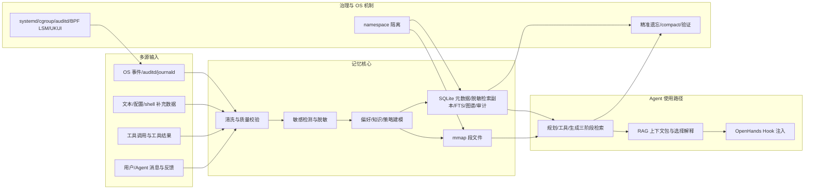

# MemGuardOS

MemGuardOS 是面向 **研究生操作系统开源创新大赛赛题 3：面向 Linux 的智能体记忆提取与精准遗忘机制** 的 Linux/openKylin 智能体记忆系统。

它提供一条本地可运行、可测试、可审计、可在 openKylin 复验的链路：从用户与 Agent 的消息、反馈、工具调用、工具结果及补充 OS 数据中提取偏好记忆与知识记忆，经过敏感治理和轻量化存储后，为真实 OpenHands Agent 构建分阶段 RAG 上下文，并支持自然语言级精准遗忘。

`Python 3.9+` · `Linux/openKylin` · `mmap + SQLite FTS` · `CLI + daemon + Unix socket API` · `MIT License`

## 目录

- [项目定位](#项目定位)
- [当前状态](#当前状态)
- [核心能力](#核心能力)
- [系统架构](#系统架构)
- [快速开始](#快速开始)
- [openKylin 复验](#openkylin-复验)
- [评测与证据](#评测与证据)
- [项目结构](#项目结构)
- [文档导航](#文档导航)
- [正式提交材料](#正式提交材料)
- [准确边界](#准确边界)

## 项目定位

OS Agent 在 Linux 桌面和开发环境中会长期处理命令、文件、配置、日志、工具调用结果和用户偏好。普通聊天记录库无法回答三个关键问题：

1. 哪些信息应该沉淀为偏好或知识，哪些只是一次性上下文。
2. 检索增强生成前，怎样在 token 预算内返回可靠、已脱敏、可追溯的记忆。
3. 用户要求“忘掉某类信息”时，怎样定位候选、确认删除、清理索引并证明明文不可再检索。

MemGuardOS 围绕这些问题构建本地智能体记忆模块。上游 Agent 可以通过 CLI 或 Unix socket API 写入工具结果、查询记忆、批量检索、生成 RAG 上下文包，再交给本地或远程 LLM 生成回答；系统默认不依赖外部 LLM API，也不需要 GPU。

## 当前状态

| 类别 | 当前结果 |
|---|---:|
| 本地功能分支单元测试 | 308 passed, 1 skipped |
| openKylin 全量测试 | 309 passed |
| openKylin 真实 Agent | OpenHands 1.28.1；原 12 组真实会话 12/12，新增 R13-R20 扩展 8/8，新增 holdout 留出盲测 8/8；合计 28 组均有证据 |
| 本地 1k 负载 P95 | 0.429 ms |
| openKylin 1k 负载 P95 | 8.904 ms |
| openKylin 10k 负载 P95 | 10.105 ms |
| openKylin 10k 负载 P99 | 75.255 ms |
| openKylin 10k RSS | 130444 KB |
| openKylin 6 线程并发检索 | 三轮最差 P95 54.381 ms；完整 10k 评测内 P95 139.264 ms |
| Recall@5 / 跨语言 Recall@5 | 1.0000 / 1.0000 |
| 敏感阻断 F1 / 脱敏 F1 / 标签 F1 | 1.0000 / 1.0000 / 1.0000 |
| 精准遗忘候选精确率 / 召回率 | 1.0000 / 1.0000 |
| 冲突处理正确率 | 1.0000 |
| benchmark 用例/种子总数 | 217 |
| Agent 交互记忆专项 benchmark | 200 条，各项指标 1.0000，openKylin P95 113.97 ms |
| 记忆价值确定性配对实验 | 16/16 系统验证通过；任务完成率 0.75→1.00；Prompt token 较完整历史减少 61.1264% |
| 真实 Agent 记忆价值实验 | 原 12/12 + 新增 8/8 完整运行；记忆系统层与 Agent 行为层均为 1.0000；未归因失败为 0 |

真实 Agent 场景库已从 12 组扩展到 28 组，新增覆盖偏好冲突覆盖、失败修复轨迹、高风险确认、跨会话 runbook 复用、精准遗忘边界和 holdout 留出盲测。新增 R13-R20 已在 openKylin 上完成独立复跑，证据位于 [docs/evidence/real_agent_extension_r13_r20_latest/](docs/evidence/real_agent_extension_r13_r20_latest/)；新增 8 组 holdout 留出盲测证据位于 [docs/evidence/real_agent_holdout_latest/](docs/evidence/real_agent_holdout_latest/)；原 12 组仍保留在 [docs/evidence/memory_value_latest/](docs/evidence/memory_value_latest/) 中，三者共同构成 28 组真实 OpenHands 证据。

通用 openKylin 证据位于 [docs/evidence/latest/](docs/evidence/latest/)，真实 Agent 专项证据位于 [docs/evidence/agent_latest/](docs/evidence/agent_latest/)，记忆价值双层评测证据位于 [docs/evidence/memory_value_latest/](docs/evidence/memory_value_latest/)，并发优化与消融证据位于 [docs/evidence/performance_latest/](docs/evidence/performance_latest/)。评测汇总见 [docs/测试报告.md](docs/测试报告.md)、[docs/真实Agent闭环测试报告.md](docs/真实Agent闭环测试报告.md)、[docs/真实Agent记忆价值评测报告.md](docs/真实Agent记忆价值评测报告.md) 和 [docs/评委证据包索引.md](docs/评委证据包索引.md)。

## 核心能力

| 能力域 | 已实现内容 | 主要入口 |
|---|---|---|
| 多源记忆接入 | 用户消息、Agent 消息、纠正反馈、工具调用、工具结果，以及文本、配置、shell、OS 事件和 auditd 补充数据 | `memctl agent-*`、`ingest-config`、`ingest-history`、`ingest-tool-result`、`ingest-os-event` |
| 真实 Agent 闭环 | OpenHands 上下文注入、真实会话事件回收、跨会话偏好复用、systemd 队列桥 | `memguard/integrations/`、`scripts/run_openhands_memguard_demo.py`、`memguard-agent@.service` |
| 记忆建模 | 偏好记忆、知识记忆、敏感策略记忆；可解释混合语义抽取；`working`、`session`、`long_term` 三层记忆；工具轨迹可建模为状态-动作-结果程序性记忆 | `memguard/extraction/semantic.py`、`memguard/models.py`、`memguard/service.py` |
| 数据质量治理 | Unicode 标准化、空输入拒绝、低质量提示、结构化字段校验、质量分入审计 | `memguard/ingestion/quality.py` |
| 轻量化存储 | mmap 追加式段文件、SQLite 元数据与脱敏检索副本、FTS、图谱边、审计哈希链 | `memguard/store/` |
| 时间有效性 | `valid_from/valid_to/superseded_by` 描述事实生效窗口，更新、提升、回滚和遗忘都会关闭旧版本窗口 | `memctl temporal-status`、`memctl versions` |
| 混合检索 | SQLite FTS、稳定 hash-vector、图谱关联、跨语言技术词扩展、冲突处理；摘要层、实体关系层、原文 chunk 层的层次图谱检索 | `memguard/retrieval/`、`memctl hierarchical-graph-search` |
| RAG 上下文 | 检索、脱敏、排序、token 预算估算、上下文包、来源分布、选择轨迹、过滤策略和 provider-neutral prompt | `memctl build-context`、`memctl build-prompt` |
| 精准遗忘 | 自然语言候选、按 Agent/会话/轮次/主题/时间范围定位、dry-run、确认删除、事件载荷清理、tombstone、FTS/图谱清理、compact、明文探针验证 | `memctl forget`、`memctl agent forget`、`verify-forget` |
| 来源信誉治理 | 外部网页、远程抓取和提示注入类内容默认进入隔离区；审批通过后才进入检索、图谱和 RAG 上下文；拒绝会写 tombstone 和审计 | `memctl governance`、`memguard/governance/trust.py` |
| 敏感治理 | PII、凭据、私钥、银行卡、中文地址、OS 高风险路径、自定义正则、自然语言敏感规则 | `memguard/sensitivity/` |
| 多会话隔离 | namespace 独立段文件、SQLite、敏感规则、审计链；systemd 模板服务配合 cgroup | `memctl --namespace`、`memguardd@.service` |
| OS 集成 | systemd、cgroup、journald、auditd、BPF LSM 可选强制拦截、JSON denylist 策略生成、openKylin 本机状态总览、Peony 文件扫描报告、UKUI 控制中心、Polkit 授权资产 | `memctl openkylin-status`、`memctl desktop scan-file`、`scripts/`、`native/` |
| Agent API | 本地 Unix socket JSON API，支持 health、ingest、search、batch_search、build_context、forget、audit 等 | `memguard/api/server.py` |
| Kylin SDK 适配 | Kylin embedding/vector SDK 探测，embedding 可选重排后端，默认保留稳定 fallback | `memctl sdk-status`、`memguard/retrieval/kylin_sdk.py` |
| 本地控制台 | localhost Web 控制台，覆盖 Agent 治理总览、交互时间线、偏好证据、三阶段上下文、交互遗忘、审计和系统诊断；支持 viewer/operator/admin 角色 token、health/readiness 和拒绝审计 | `memctl web`、`memguard/web/dashboard.py` |
| 外部基准适配 | LongMemEval-V2 官方 schema 适配，提供 `insert()`/`query()` 兼容后端、上游 revision 记录和检索层/答案层指标隔离 | `memguard/integrations/longmemeval_v2.py`、`scripts/run_longmemeval_v2.py` |
| 企业交付能力 | 严格记忆开关资源对照、SLO 门禁、可校验备份恢复、release attestation、Nginx HTTPS 反向代理模板和遗忘边界声明 | `scripts/run_resource_control.py`、`scripts/check_slo.py`、`scripts/backup_memguard.py`、`config/nginx/memguardos.conf` |

## 系统架构



整体设计选择是“端侧稳定优先”：默认主链路不依赖云端 API、GPU 或重量级向量数据库；在 openKylin 环境存在 Kylin SDK 时启用探测和可选增强，在 SDK 不可用或超时时自动回退到稳定检索路径。参考新式 Agent Memory 中 temporal knowledge graph 的做法，MemGuardOS 为每条记忆维护时间有效性窗口。旧偏好或知识被更新、提升、回滚或遗忘时，系统会写入 `valid_to` 与 `superseded_by`，普通检索只读取当前有效记忆，历史版本仍可通过版本列表和审计链追溯。

## 快速开始

### 1. 安装与测试

```powershell
cd <项目目录>
python -m pip install -e ".[dev]"
python -m pytest -q
python scripts/demo_smoke.py
```

### 2. 写入和检索记忆

```powershell
python -m memguard.cli.memctl ingest --text "以后回答 Linux 命令时直接给命令和风险提示。"
python -m memguard.cli.memctl ingest-config --file data/demo/user_config.json
python -m memguard.cli.memctl ingest-tool-result --file data/demo/tool_result_success.json
python -m memguard.cli.memctl search "Linux 命令回答偏好"
```

工具结果 JSON 可选带上 `state_before`、`state_after` 和 `lesson` 字段。存在这些字段时，MemGuardOS 会将工具轨迹写成状态-动作-结果程序性记忆，供 OS Agent 在后续自动调试、服务恢复、测试复跑和证据生成时复用。

### 3. 为 Agent 构建 RAG 上下文

```powershell
python -m memguard.cli.memctl batch-search "任务规划 systemd cgroup" "工具调用 pytest journalctl" "结果生成 运维证据"
python -m memguard.cli.memctl build-context "openKylin 服务内存限制" --top-k 5 --token-budget 1200
python -m memguard.cli.memctl build-prompt "openKylin 服务内存限制" --top-k 5 --token-budget 1200
python -m memguard.cli.memctl hierarchical-graph-search systemd --limit 5
```

`build-context` 返回 `explainability` 字段，说明来源分布、类型分布、层级分布、敏感等级分布和每条候选的选择轨迹。上游 Agent 可以据此判断“为什么这些记忆被交给 LLM”，评委也能复核上下文构建、敏感过滤和预算裁剪过程。

### 4. 查看抽取解释和 Web 控制台

```powershell
python -m memguard.cli.memctl explain-extraction --text "真实案例：systemd service failed with exit_code=1，修复后运行 pytest。"
python -m memguard.cli.memctl web --host 127.0.0.1 --port 8765
```

### 5. 接入现有 OpenHands Agent

核心功能不依赖 Agent 额外环境。需要验证真实闭环时，在 openKylin 上安装可选依赖并运行：

```bash
bash scripts/install_agent_extras_openkylin.sh "$(pwd)"
.venv-agent/bin/python scripts/run_openhands_memguard_demo.py \
  --namespace realagent-demo \
  --session-id real-agent-session-a \
  --task "以后搜索代码使用 rg，并先给命令再解释。请查找 build_agent_context。" \
  --max-iterations 8
```

完整安装、模型配置、systemd bridge、交互遗忘和排障步骤见 [docs/真实Agent接入使用说明.md](docs/真实Agent接入使用说明.md)。

### 6. 精准遗忘和审计

```powershell
python -m memguard.cli.memctl forget "忘掉 temporary project codename"
python -m memguard.cli.memctl forget "忘掉 temporary project codename" --yes --compact
python -m memguard.cli.memctl verify-forget "temporary project codename"
python -m memguard.cli.memctl temporal-status --limit 10
python -m memguard.cli.memctl verify-audit
```

### 7. 多会话隔离

```powershell
python -m memguard.cli.memctl --namespace demo-a ingest --text "demo-a 会话只保存 systemd MemoryMax 方案。"
python -m memguard.cli.memctl --namespace demo-b search MemoryMax
python -m memguard.cli.memctl --namespace demo-a namespace-status
```

## openKylin 复验

在 openKylin 虚拟机中：

```bash
cd ~/memguardos
source .venv/bin/activate
python -m pytest -q
bash scripts/openkylin_verify.sh
bash scripts/collect_openkylin_evidence.sh --with-10k
bash scripts/collect_agent_evidence.sh
```

systemd/cgroup、auditd、SDK、UKUI、BPF LSM 常用验证入口：

```bash
sudo bash scripts/install_openkylin.sh "$(pwd)"
sudo systemctl start memguardd
systemctl show memguardd -p MemoryMax -p CPUQuotaPerSecUSec
python -m memguard.cli.memctl openkylin-status
python -m memguard.cli.memctl openkylin-status --probe-sdk --probe-timeout 90
python -m memguard.cli.memctl auditd-rules --format auditctl
python -m memguard.cli.memctl sdk-status --probe-embedding --probe-timeout 90
bash scripts/warmup_kylin_sdk.sh
python -m memguard.cli.memctl desktop scan-files --file README.md
python -m memguard.cli.memctl search "openKylin 服务内存限制" --top-k 2
bash scripts/collect_openkylin_native_evidence.sh
```

生成 openKylin/Debian 安装包：

```bash
bash scripts/build_deb.sh
sudo apt install ./dist/memguardos-core_0.1.0-2_amd64.deb \
  ./dist/memguardos-ukui_0.1.0-2_amd64.deb \
  ./dist/memguardos-agent-bridge_0.1.0-2_amd64.deb \
  ./dist/memguardos-doc_0.1.0-2_all.deb \
  ./dist/memguardos_0.1.0-2_all.deb
memctl doctor
sudo systemctl start memguardd
```

`build_deb.sh` 生成五个职责独立的包：`memguardos-core` 提供 CLI、daemon、systemd、Polkit 和 BPF 安全验证资产；`memguardos-ukui` 提供 Peony、UKUI 控制中心和系统托盘；`memguardos-agent-bridge` 提供 OpenHands/Agent 桥接；`memguardos-doc` 提供中文文档；`memguardos` 是完整安装元包。分包构建会检查文件所有权冲突，`verify_deb_lifecycle.sh` 会验证离线安装、桌面包移除与重装以及用户数据保护。旧版单包的维护模式安装证据继续保留；新版五包需在最终 HEAD 下刷新一次维护模式 `apt install` 证据。

## 评测与证据

本地 1k 负载评测：

```bash
python -m memguard.eval.run_eval --latency-size 1000 --latency-queries 120 --output docs/eval_result.json --markdown docs/eval_report.md
```

openKylin 10k 规模评测：

```bash
python -m memguard.eval.run_eval --latency-size 10000 --latency-queries 150 --output docs/eval_result_openkylin_10k.json --markdown docs/eval_report_openkylin_10k.md
```

关键证据入口：

| 你要核查什么 | 推荐入口 |
|---|---|
| 赛题要求是否覆盖 | [docs/赛题符合性说明.md](docs/赛题符合性说明.md) |
| 功能、指标和 openKylin 结果 | [docs/测试报告.md](docs/测试报告.md) |
| 评委现场证据文件 | [docs/评委证据包索引.md](docs/评委证据包索引.md) |
| OS 机制实现 | [docs/操作系统机制说明.md](docs/操作系统机制说明.md) |
| openKylin 原生化适配 | [docs/openKylin原生化适配说明.md](docs/openKylin原生化适配说明.md) |
| Peony/UKUI 桌面集成 | [docs/Peony与UKUI桌面集成实现说明.md](docs/Peony与UKUI桌面集成实现说明.md)，Peony smoke 见 `scripts/peony_file_scan_smoke.sh` |
| Kylin SDK 适配 | [docs/麒麟SDK集成证据.md](docs/麒麟SDK集成证据.md) |
| 安全与精准遗忘 | [docs/安全设计说明书.md](docs/安全设计说明书.md) |
| 遗忘保证边界与企业安全制品 | [docs/安全与遗忘保证边界.md](docs/安全与遗忘保证边界.md) |
| 外部标准基准适配 | [docs/外部标准基准说明.md](docs/外部标准基准说明.md) |
| 真实 OpenHands Agent 接入 | [docs/真实Agent接入使用说明.md](docs/真实Agent接入使用说明.md)、[docs/真实Agent闭环测试报告.md](docs/真实Agent闭环测试报告.md)、[docs/真实Agent记忆价值评测报告.md](docs/真实Agent记忆价值评测报告.md) |

## 项目结构

```text
memguardos/
├── memguard/       # 核心 Python 包：接入、建模、存储、检索、遗忘、安全、OS 适配、API
│   └── integrations/ # OpenHands 事件规范化、偏好聚合、上下文注入、runner 与 bridge
├── scripts/        # 部署、验证、演示、证据采集、auditd/BPF/UKUI/Kylin SDK 脚本
├── native/         # BPF LSM、Peony 右键插件、UKUI 控制中心插件源码
├── tests/          # 核心功能、评测边界和回归测试
├── data/           # demo 输入、benchmark 样例和评测数据
├── docs/           # 正式中文文档、评测报告和 openKylin 证据包
├── pyproject.toml  # Python 包与开发依赖配置
└── LICENSE         # MIT License
```

完整工程仓库还包含 `.github/`、`.devcontainer/`、`Makefile`、贡献指南、变更日志、打包脚本和自检脚本。这些材料用于协作、CI、备份和工程维护，不作为正式竞赛作品主体。

## 文档导航

项目新增统一中文文档索引 [PROJECT_INDEX.md](PROJECT_INDEX.md)，用于说明每个文件和文件夹的作用、历史文件整理建议、运行入口、构建测试流程和后续维护建议。

编号文档体系用于快速定位不同读者需要的资料：

| 阅读目标 | 推荐文档 |
|---|---|
| 从零理解项目、准备截图验收和答辩 | [项目全流程导师资料包/README.md](项目全流程导师资料包/README.md) |
| 了解项目是什么 | [docs/01_项目简介.md](docs/01_项目简介.md) |
| 学会使用命令和控制台 | [docs/02_用户手册.md](docs/02_用户手册.md) |
| 部署、启动、证据采集 | [docs/03_操作手册.md](docs/03_操作手册.md)、[docs/12_环境依赖与部署.md](docs/12_环境依赖与部署.md) |
| 继续开发和理解源码 | [docs/04_开发者文档.md](docs/04_开发者文档.md)、[docs/06_代码结构说明.md](docs/06_代码结构说明.md) |
| 理解架构、模块和算法 | [docs/05_项目架构说明.md](docs/05_项目架构说明.md)、[docs/07_核心模块说明.md](docs/07_核心模块说明.md)、[docs/08_算法说明.md](docs/08_算法说明.md) |
| 对接 Agent 或 API | [docs/09_接口文档.md](docs/09_接口文档.md) |
| 查看数据、配置、测试和 FAQ | [docs/10_数据说明.md](docs/10_数据说明.md)、[docs/11_配置说明.md](docs/11_配置说明.md)、[docs/13_测试说明.md](docs/13_测试说明.md)、[docs/14_常见问题FAQ.md](docs/14_常见问题FAQ.md) |
| 了解版本、历史和交付 | [docs/15_更新日志.md](docs/15_更新日志.md)、[docs/16_历史文件说明.md](docs/16_历史文件说明.md)、[docs/17_项目交付说明.md](docs/17_项目交付说明.md) |
| 检查供应链与核心文件哈希 | [docs/供应链与SBOM说明.md](docs/供应链与SBOM说明.md)、[docs/sbom.json](docs/sbom.json) |

## 正式提交材料

正式竞赛提交包由完整工程仓库生成：

```bash
python scripts/release_preflight.py
python scripts/generate_sbom.py
python scripts/package_submission.py
python scripts/sign_release.py dist/<submission.zip> --output-dir dist/attestation
```

`release_preflight.py` 会顺序执行编译检查、ruff、单元测试、文档链接检查、Web 控制台 smoke、竞赛就绪自检，并在未指定 `--skip-package` 时生成提交包。`generate_sbom.py` 会刷新 `docs/sbom.json` 和 `docs/供应链与SBOM说明.md`，用于记录核心源码、脚本、原生增强和 benchmark 数据的哈希。它们属于工程自检工具，提交包会包含生成后的 SBOM 交付件。

`sign_release.py` 会生成 SHA256SUMS 和 release attestation；如果本机存在可用 minisign 或 GPG 签名密钥，会生成真实签名，否则明确标记 `not_configured`，只声明校验和，不伪造签名。

生成后可单独审计提交包内容：

```bash
python scripts/inspect_submission_package.py
```

该审计会检查正式包是否包含核心代码、正式中文文档和最新证据，同时确认未混入 GitHub/CI、预检脚本、自检报告、缓存、数据库、段文件等过程或运行时材料。

为确认平台上传的压缩包本身可以独立运行核心演示，可继续执行归档包 smoke：

```bash
python scripts/smoke_submission_archive.py
```

该命令会读取最新 `memguardos_competition_submission_*.zip`，先复用提交包内容审计，再将正式包解压到临时目录，并从解压后的源码运行编译检查、CLI 演示 smoke 和 Web 控制台 smoke。它是交付前质检工具，不会放入正式竞赛提交包主体。

生成结果包括：

```text
dist/memguardos_competition_submission_<时间戳>.zip
dist/memguardos_competition_submission_<时间戳>_manifest.json
dist/memguardos_full_repository_<时间戳>.zip
dist/memguardos_full_repository_<时间戳>_manifest.json
```

竞赛平台优先提交 `memguardos_competition_submission_*.zip`。该包包含源码、部署验证脚本、测试数据、正式中文文档、评测报告和 openKylin 证据；不包含 GitHub 协作模板、过程追踪表、临时缓存、虚拟环境、个人笔记或仅用于工程自检的脚本。边界说明见 [docs/正式提交材料说明.md](docs/正式提交材料说明.md)。

正式评审建议按以下顺序阅读：

1. [docs/项目介绍总览.md](docs/项目介绍总览.md)
2. [docs/最终提交说明.md](docs/最终提交说明.md) 和 [docs/平台摘要.md](docs/平台摘要.md)
3. [docs/赛题符合性说明.md](docs/赛题符合性说明.md)
4. [docs/概要设计说明书.md](docs/概要设计说明书.md) 和 [docs/详细设计说明书.md](docs/详细设计说明书.md)
5. [docs/部署手册.md](docs/部署手册.md) 和 [docs/用户手册.md](docs/用户手册.md)
6. [docs/测试报告.md](docs/测试报告.md) 和 [docs/评委证据包索引.md](docs/评委证据包索引.md)
7. [docs/答辩提纲.md](docs/答辩提纲.md)、[docs/答辩稿.md](docs/答辩稿.md) 和 [docs/演示视频脚本.md](docs/演示视频脚本.md)

## 准确边界

- Kylin embedding SDK：已完成真实向量探针和可选重排检索证据；默认主路径仍保留 FTS/hash/graph fallback。
- Debian 安装包：历史单包已在 openKylin 维护模式完成完整 `apt install` 安装复验；当前版本已升级为五个职责独立的包，并已通过构建、文件冲突检查和离线生命周期验证。最终提交前建议在维护模式下按当前 Git HEAD 再跑一次五包 `apt install` 证据。
- 语义抽取：默认采用可解释、可复现的 deterministic semantic rules；显式配置 `MEMGUARD_EXTRACTOR_COMMAND` 后可接本地 NER/LLM JSON 增强器，增强器失败会自动回退。
- BPF LSM：已在 openKylin 对安全测试文件完成强制拒绝验证；支持从 JSON 生成可审查静态 denylist；默认不拦截 `/etc/shadow`、SSH、sudo 或 PAM 链路。
- UKUI/Peony：Peony 右键菜单插件已在 openKylin 桌面右键菜单中可见验证；当前菜单动作采用 `memctl desktop scan-files` 预览和 `memctl desktop apply-scan` 确认执行，对用户主动选择的文件生成批量扫描清单，高风险敏感文本阻断写入，目录/大文件/非文本文件只记录 OS event，安全文本在用户确认后进入 `peony_file` 导入链路。UKUI 控制中心入口“MemGuardOS 记忆安全”已升级为本机运维面板，包含服务状态、服务级 cgroup、本机智能检索、Kylin SDK 预热、审计链、Polkit 高权限动作、诊断报告和本地控制台入口；打开设置页和运行 `openkylin-status` 时默认使用轻量状态，完整 SDK 推理探针只在用户主动检查、预热或显式传入 `--probe-sdk` 时执行，避免 SDK 冷启动拖慢系统设置；UKUI 托盘提供低干扰状态提醒和快捷入口。
- Web 控制台：用于本地运维、调试和评审操作，默认绑定 `127.0.0.1`，不作为公网 SaaS 管理台。
- 用户行为：主链路采集用户与 OpenHands Agent 的消息、反馈、工具调用和工具结果；shell、配置、OS 事件和 auditd 是补充来源，不宣称全量桌面行为捕获。
- 真实 Agent：原 12 组 openKylin/OpenHands 会话和新增 R13-R20 8 组扩展会话均已完成归档，记忆系统层与 Agent 行为层合计 28/28。系统保留模型原始尝试，并通过偏好 Hook、有界合规修复、严格只读结构化意图恢复和程序性结果兜底提高小模型稳定性；该结果仅代表当前公开场景，不扩展为任意 Agent 任务均稳定完成。
- 交互遗忘：保证 MemGuardOS 管理的事件、记忆、索引、图谱和段文件边界；OpenHands 原始会话、shell history、模型服务日志和外部备份需使用各自删除机制。
- 外部 LLM：默认不依赖外部 API；只有显式选择 provider 时才调用本地命令或兼容远程端点。
- 真实 Agent 场景库：代码库中的可复现 OpenHands 场景定义已扩展到 28 组；原始记忆价值证据包归档 R01-R12，扩展证据包归档 R13-R20，holdout 留出证据包归档 H01-H08。答辩或提交时应说明三份证据目录共同组成 28 组真实运行证据。

## 许可证

MemGuardOS 使用 MIT License，见 [LICENSE](LICENSE)。


