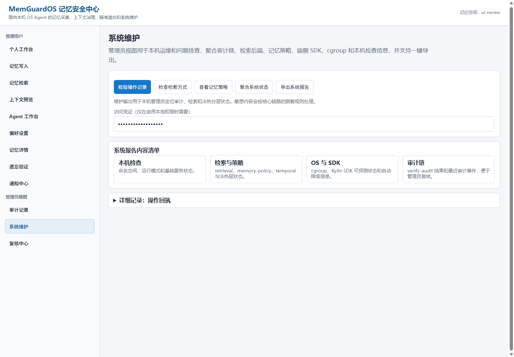
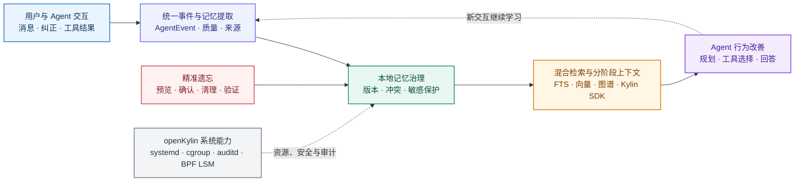
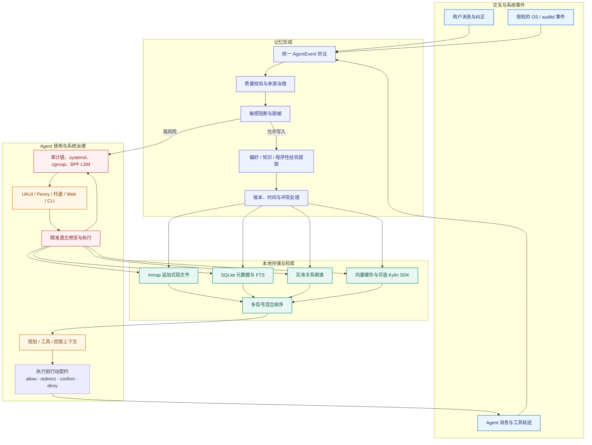

<div align="center">


# MemGuardOS

**面向 openKylin 与 Linux OS Agent 的本地记忆提取、上下文增强与精准遗忘系统**

让 Agent 从用户纠正、工具调用和执行结果中持续学习，同时让每一条记忆可查看、可追溯、可控制、可遗忘。

<p>
      
</p>
<p>
     
</p>
<p>
    
</p>

[快速体验](#快速体验) · [核心能力](#核心能力) · [真实-agent-接入](#真实-agent-接入) · [项目结构](#项目结构) · [系统架构](#系统架构) · [验证结果](#验证结果) · [完整文档](#完整文档) · [演示视频](#演示视频)

</div>

<a id="演示视频"></a>

## 🎬 演示视频

<video controls preload="metadata" poster="docs/assets/branding/demo-video-cover.jpg" width="100%">
  <source src="MemGuardOS-演示视频-头脑特工队.mp4" type="video/mp4">
  当前浏览器不支持在线播放，请打开 <a href="MemGuardOS-演示视频-头脑特工队.mp4">MemGuardOS 演示视频</a>。
</video>

<p align="center">4 分 58 秒核心流程演示：openKylin 桌面入口、工具结果与偏好记忆提取、新会话复用、版本更新、精准遗忘、敏感信息保护及 Web 可追溯证据链。</p>

MemGuardOS 是部署在本机的 OS Agent 记忆层。它接收用户与 Agent 的交互事件，提取长期偏好、知识和工具经验，在下一次任务中按需提供分阶段上下文，并为每次注入生成包含记忆版本和作用域的可复核收据；当用户要求遗忘时，系统先展示候选和影响范围，再清理受管存储、检索索引、图谱、缓存和段文件中的目标内容。

系统默认离线运行，不要求 GPU，也不会把原始记忆上传到云端。openKylin 用户可以从 UKUI 系统设置、Peony 文件右键菜单、系统托盘和本地工作台使用；Agent 开发者可以通过 Python API、标准事件 JSON、JSONL 或 Unix socket 接入。

<table>
  <tr>
    <td align="center" width="25%"><b>真实 Agent 复用</b><br>新会话自动采用工具与回答偏好，记录实际行为证明和上下文版本收据</td>
    <td align="center" width="25%"><b>精准遗忘闭环</b><br>自然语言预览、编号确认、多检索表面清理与残留复核</td>
    <td align="center" width="25%"><b>端侧高效检索</b><br>10k 记忆负载 P95 10.105 ms，支持延迟预算与透明回退</td>
    <td align="center" width="25%"><b>openKylin 原生交付</b><br>UKUI、Peony、托盘、系统服务与五包安装链路</td>
  </tr>
</table>

| 个人工作台 | 系统维护 |
| --- | --- |
|  |  |
| 查看最近学习内容、检索记忆、预览上下文和执行遗忘 | 查看服务、检索后端、SDK、审计链和本机资源状态 |

<a id="项目结构"></a>

## 🗂️ 项目结构

```text
memguard/                  Python 核心、CLI、服务、Agent 适配与 Web 工作台
  api/                     本地 API 与 Unix socket 协议
  extraction/              偏好、知识和程序性经验提取
  retrieval/               FTS、向量、图谱、融合排序与缓存
  forgetting/              自然语言解析、ErasurePlan 与遗忘执行
  governance/              来源、隔离区、冲突和生命周期治理
  integrations/            OpenHands 等 Agent 适配层
  os_guard/                cgroup、auditd、BPF LSM 与本机状态探针
  web/                     本地用户工作台与管理员控制台
native/                    UKUI、Peony、托盘和 BPF LSM 原生组件
packaging/                 Debian、desktop、Polkit 与系统集成资产
scripts/                   安装、构建、评测、证据采集和发布脚本
data/                      演示数据与可复现评测数据集
tests/                     单元、集成、安全、桌面与交付测试
docs/                      正式文档、截图与精选可复核证据
```

仓库以可安装、可运行、可评测和可复现为整理原则，源代码、原生组件、安装资产、测试、正式文档与验证证据各自归入明确目录；发行版通过版本标签和 SHA-256 清单提供可追溯交付。

<a id="系统架构"></a>

## 🧭 系统架构总览

MemGuardOS 位于 Agent 与 openKylin 之间：向上提供记忆与上下文，向下使用本地存储、审计和系统安全能力。核心链路通过统一 AgentEvent 协议兼容不同交互界面，OpenHands 提供已经完成真实验证的第一方适配实现；上下文构建同时返回所选记忆的当前版本映射和稳定指纹，执行前可以复核上下文是否因更新或遗忘而失效。工具真正执行前，还可以通过行动契约核对当前记忆、作用域和拟执行参数，得到允许、改用建议、确认或拒绝的可审计判定。



### 技术亮点

<table>
  <tr>
    <td align="center" width="33%">🧠<br><b>交互记忆提取</b><br>统一 AgentEvent 承载用户纠正、工具调用与执行结果，形成偏好、知识和程序性经验</td>
    <td align="center" width="33%">⚡<br><b>多信号混合检索</b><br>融合 FTS、向量、图谱、时间、来源和工具行为信号，并受端侧延迟预算约束</td>
    <td align="center" width="33%">🎯<br><b>三阶段上下文与行动契约</b><br>分阶段检索并生成版本收据，工具执行前返回允许、改用、确认或拒绝判定</td>
  </tr>
  <tr>
    <td align="center">🧹<br><b>可验证精准遗忘</b><br>自然语言生成 ErasurePlan，先看候选和影响，再清理正文、索引、图谱与缓存</td>
    <td align="center">🔐<br><b>本地敏感治理</b><br>凭据写入前阻断，个人信息脱敏，来源、版本、使用和遗忘过程均可审计</td>
    <td align="center">🐧<br><b>openKylin 原生交付</b><br>UKUI、Peony、托盘、systemd、cgroup、Polkit 与五个 Debian 包协同工作</td>
  </tr>
</table>

更完整的模块关系、存储结构和精准遗忘数据流见后文[技术实现与关键设计](#技术实现与关键设计)。

## 🎯 它解决什么问题

OS Agent 会反复处理命令、文件、工具和系统状态。只有聊天记录时，Agent 很难稳定区分长期偏好、一次性指令、工具失败经验和敏感数据；传统向量库虽然能找回文本，却通常没有完整的来源追踪、冲突治理和遗忘验证。

MemGuardOS 将“记住、用好、忘干净”串成一个可验证的本地闭环：

| 阶段 | 没有受治理记忆时 | 使用 MemGuardOS 后 |
|---|---|---|
| 学习 | 用户每次都要重复说明工具和回答偏好 | 从用户纠正、工具成功/失败和显式设置中提取有效记忆 |
| 复用 | Agent 只看到当前会话，容易重复试错 | 在规划、工具选择、回答生成前分别注入所需上下文 |
| 更新 | 新旧偏好并存，Agent 不知道应采用哪一条 | 记录版本、时间和来源，处理覆盖、冲突与有效期 |
| 安全 | Token、凭据或个人信息可能被长期保存 | 高风险内容写入前阻断，可保留个人信息先脱敏 |
| 遗忘 | 全量删除容易误伤，只删数据库又可能留下索引残留 | 先预览影响，再按主题、类型、时间、来源或编号精准遗忘 |
| 审计 | 难以回答“为什么记住、何时使用、是否删净” | 保留来源、使用记录、上下文版本收据、哈希链审计和残留验证结果 |

### 🔄 一次真实使用会发生什么

1. 用户告诉 Agent：“以后搜索代码优先使用 `rg`，回答先给结论。”
2. MemGuardOS 将用户消息归一化为标准事件，提取“搜索工具偏好”和“回答格式偏好”。
3. 用户开启新会话，只描述任务，不再重复上述偏好。
4. Agent 在规划和工具选择前收到与当前任务相关的记忆，优先调用 `rg`，并按偏好组织答复；系统同时记录采用的记忆、实际命令和偏好遵循结果。
5. 用户提出“忘掉搜索工具偏好”，系统先列出候选、记忆编号和匹配依据，确认后只删除工具偏好，回答格式偏好仍保留。
6. 系统继续复核主记录、FTS、图谱、向量与结果缓存、追加式段文件和 Agent 上下文；再次执行任务时，已遗忘偏好不再参与生成，审计链保留必要的操作证明。

<a id="核心能力"></a>

## ✨ 核心能力

| 能力 | 实现方式 | 用户可见结果 |
|---|---|---|
| 多源交互记忆提取 | 用户消息、Agent 消息、反馈、工具调用、工具结果和授权 OS 事件统一进入事件协议 | 纠正、工具偏好和成功/失败经验自动形成记忆 |
| 分阶段上下文与行动契约 | 规划、工具选择、回答生成使用不同检索目标与 token 预算；工具执行前复核记忆版本、作用域和参数 | Agent 只获得当前阶段需要的记忆，并在真正调用工具前得到可解释的允许、改用、确认或拒绝结果 |
| 混合检索 | SQLite FTS、稳定向量、实体关系图谱、持久化缓存与可选 Kylin SDK 重排 | 中文、英文、跨语言和工具语义均可检索，并按相关度排序 |
| 版本与冲突治理 | 版本链、时间有效性、来源证据、置信度和冲突策略 | 新偏好覆盖旧偏好，同时保留可审计的变更历史 |
| 精准遗忘 | 自然语言解析、结构化 `ErasurePlan`、dry-run、确认、墓碑、索引清理与压缩 | 删除前看影响，删除后验证目标不再召回且无明文残留 |
| 敏感内容保护 | 凭据阻断、PII 脱敏、自定义规则、来源隔离与审计 | 高风险内容不会进入长期记忆，用户能看到阻断原因 |
| openKylin 原生集成 | UKUI 设置插件、Peony 右键、托盘通知、systemd、cgroup、auditd、Polkit、BPF LSM | 普通用户和管理员都能从系统原生入口完成操作 |
| 可复现交付 | 五个 Debian 包、版本清单、SHA-256、SBOM、CI、实机证据和发布门禁 | 可安装、可复验、可追溯到明确 Git 修订 |

## 👥 使用入口

| 使用者 | 推荐入口 | 适合完成的操作 |
|---|---|---|
| openKylin 普通用户 | UKUI“记忆安全中心”、系统托盘 | 查看服务状态、最近学习内容、偏好、通知和遗忘结果 |
| 文件管理用户 | Peony 右键“检查记忆内容” | 扫描一个或多个文件，预览候选和敏感风险，确认后导入 |
| Agent 使用者 | `memguard-agent-showcase` | 用自然语言运行真实 Agent，切换记忆开关，观察学习和复用 |
| 本机管理员 | Web 工作台“系统维护”、`memctl` | 校验审计链、SDK、systemd、cgroup、安全策略和诊断包 |
| Agent 开发者 | Python API、JSON/JSONL、Unix socket | 写入标准事件、构建上下文、执行遗忘和读取审计结果 |

真实自然语言任务由已经接入的 Agent 执行，Web 工作台专注于本机记忆查看、检索、遗忘、安全治理与系统维护。

<a id="快速体验"></a>

## 🚀 快速体验

### ① 三分钟体验记忆闭环

Python 3.10 及以上环境可以直接从源码安装：

```bash
git clone https://github.com/Alexd-star/memguardos.git
cd memguardos
python3 -m venv .venv
source .venv/bin/activate
python -m pip install -U pip
python -m pip install -e .
```

Windows PowerShell 使用 `.venv\Scripts\Activate.ps1` 激活环境。开发和测试环境使用 `python -m pip install -e ".[dev,security]"`。

运行可读的确定性闭环演示：

```bash
memguard status
memguard demo
```

`memguard demo` 用本地事件回放稳定展示写入、检索、上下文和遗忘预览，不调用真实模型，也不会冒充真实 Agent 结果。随后可以逐步操作真实数据：

```bash
memguard remember "以后查找代码时优先使用 rg，并先说明命令风险。"
memguard search "搜索代码工具"
memguard context "在项目中定位配置加载逻辑"
memguard forget "忘掉搜索工具偏好"
memguard forget "忘掉搜索工具偏好" --yes --compact
memguard audit
```

`forget` 默认只预览候选；只有带 `--yes` 才会执行，`--compact` 会继续整理追加式段文件。
临时记忆属于具体会话：`memguard shell` 会自动创建并在正常退出时清理；单条命令可用 `memguard remember "本次会话临时记录构建步骤" --session-id demo-01`，之后用同一 `--session-id` 搜索，最后执行 `memguard end-session --session-id demo-01 --yes`。长期记忆不随会话结束删除。

异常退出留下的临时会话可用 `memctl stale-sessions --older-than-hours 72` 预览，再按会话编号逐项确认清理。真实 Agent 的工具结果先进入会话记忆；只有完整任务通过校验、同一工具在至少两个独立会话成功后，系统才形成不含原始命令的项目级工具经验，且不会把执行统计冒充用户偏好。

### ② 在 openKylin 安装完整桌面版

需要复现当前 `main` 的最新代码时，建议在 openKylin 构建机准备 `qmake`、`pkg-config`、`libpeony-dev`、`libukcc-dev` 和 Qt5 开发包，然后直接从源码构建并安装五包：

```bash
git clone https://github.com/Alexd-star/memguardos.git
cd memguardos
bash scripts/build_ukui_plugins.sh
bash scripts/install_deb_package_set.sh
```

`install_deb_package_set.sh` 会重新构建五包，通过生成清单确认包名和路径，使用 APT 安装，并复核 systemd、CLI、Polkit、托盘入口和审计链。若已经取得构建完成的五个 `.deb` 文件，也可以在同一目录直接执行：

```bash
sudo apt install ./memguardos-core_*.deb \
  ./memguardos-ukui_*.deb \
  ./memguardos-agent-bridge_*.deb \
  ./memguardos-doc_*.deb \
  ./memguardos_[0-9]*_all.deb

systemctl status memguardd --no-pager
memguard status
```

安装完成后，`memguardd` 会由 systemd 自动启动并设置为开机运行。日常使用不需要进入源码目录，也不需要手动启动服务；`memguard`、`memctl` 和桌面入口可从任意工作目录使用。

如果只需要核心服务、源码和 systemd 单元，不需要 UKUI、Peony、托盘与 Debian 分包，可以执行轻量源码部署：

```bash
sudo bash scripts/install_openkylin.sh "$(pwd)"
```

轻量脚本适合快速体验核心闭环；用于评审复现或其他 openKylin 机器部署时，推荐采用上面的 `install_deb_package_set.sh` 完成桌面五包安装。

安装桌面包后，可以从开始菜单打开“MemGuardOS 记忆安全”，或在 UKUI 系统设置的安全分类中进入记忆安全中心。完整环境依赖、安装验证、升级和卸载步骤见 [安装部署](docs/installation.md)。

### ③ 打开本地工作台

```bash
memctl web --host 127.0.0.1 --port 8765
```

浏览器访问 `http://127.0.0.1:8765`。工作台默认只监听本机地址，不应直接暴露到公网。

<a id="真实-agent-接入"></a>

## 🤖 真实 Agent 接入

MemGuardOS 不要求 Agent 使用特定界面。接入方只需发送统一事件，并在规划、工具选择或回答生成前请求上下文。当前完成端到端实机验证的第一方适配器是 OpenHands；其他 Agent 可以按相同协议接入，但需要实现并验证各自的事件映射层。

### 使用 OpenHands 运行自然语言任务

OpenHands 是运行自然语言 Agent 的可选适配器，不影响本地记忆管理、文件扫描、检索、遗忘和审计。五包安装后，首次使用真实 Agent 时执行一次：

```bash
memguard-agent-setup
```

配置模型后，可以在任意目录指定 Agent 的工作区，无需手动进入 MemGuardOS 源码目录：

```bash
memguard-agent-showcase "$HOME/要操作的项目"
```

通过上述入口启动 OpenHands 时，MemGuardOS 会自动挂载事件采集、上下文适配和执行前行动检查；其他 Agent 可按照统一 AgentEvent 协议接入，并在工具调用前使用同一行动契约。源码开发环境也可直接使用 `memguard --workspace "$(pwd)" --model "<模型名称>" shell`。

交互工作台内可以完成一轮清晰的记忆效果对照：

```text
/guide
/memory off
/run 在当前项目中查找精准遗忘的实现位置
/memory on
/run 在当前项目中查找精准遗忘的实现位置
/preferences
/forget 忘掉搜索工具偏好
yes
/audit
```

`/run` 用于运行真实 Agent；输入 `/run 忘掉……` 或直接输入“忘掉……”时，工作台会识别记忆治理意图并进入遗忘预览。只有一条候选时输入 `yes` 或“确认”即可；出现多条候选时，先输入 `1`、`1,3` 等编号，或输入“全部”，再确认执行。输入 `no` 或“取消”则停止。真实任务会显示记忆开关、采用记忆数量、工具调用、最终答复、偏好作用验证、上下文版本收据和本次记忆变化；运行前配置检查会给出 Agent、模型与网络状态及对应处理指引，展示结果均来自实际执行记录。

自然语言入口采用“确定性安全规则 + 结构化语义提取 + 拒绝猜测”的分层策略。查看、检索、运行、保存和遗忘等高频意图支持常见礼貌表达；密码、口令、验证码和密钥在任何语义增强之前由本机规则阻断；“本次会话”“当前任务”“长期保存”等表述直接进入对应保留层级。系统只在意图明确时改变记忆状态，疑问句不会形成偏好，无法可靠判断是任务还是记忆的输入会要求用户选择 `/run` 或“记住：”，避免用错误的自动化换取表面上的“什么都能听懂”。

也可以用一条命令执行同任务双臂对照：

```bash
memguard --workspace "$(pwd)" --model "<模型名称>" \
  compare-live "在当前项目中查找精准遗忘的实现位置"
```

### 通用接入方式

```text
Agent / CLI / Desktop
        |
        | AgentEvent(JSON) / Python API / JSONL / Unix socket
        v
MemGuardOS 事件接入 -> 提取与治理 -> 检索与上下文 -> 事件回写与审计
```

标准事件包含会话、序号、角色、事件类型、工具名称、工具参数、执行结果和来源。接入协议、事件示例、OpenHands 配置和安全注意事项见 [Agent 接入](docs/agent-integration.md) 与 [接口参考](docs/api.md)。

<a id="技术实现与关键设计"></a>

## 🧩 技术实现与关键设计



### 关键设计

1. **统一事件，而不是绑定某个聊天界面。** 用户消息、Agent 回答、工具调用和工具结果都转成稳定协议，适配器只负责映射，不把核心记忆逻辑写死在 OpenHands 中。
2. **记忆先治理再存储。** 每条候选先经过质量、来源和敏感检查，再决定阻断、隔离、脱敏或写入，避免“先存下来以后再说”。
3. **检索不是单一向量相似度。** 系统融合全文、稳定向量、图谱、时间、类型、来源和工具行为信号，并使用延迟预算控制 Kylin SDK 重排与 fallback。
4. **上下文按 Agent 阶段拆分。** 规划阶段关注目标和约束，工具阶段关注工具偏好与失败经验，回答阶段关注格式和表达偏好，减少无关记忆挤占 Prompt。
5. **遗忘是结构化计划。** 自然语言先解析成主题、类型、时间、来源和 namespace 过滤条件，生成可预览的 `ErasurePlan`，确认后清理所有受管检索表面并执行残留验证。
6. **把操作系统能力纳入记忆治理。** systemd 管理服务，cgroup 限制资源，auditd 和哈希链记录审计，Polkit 管理高权限动作，BPF LSM 提供敏感路径强制策略。
7. **让记忆参与行动决策。** Agent 收到上下文后，工具真正执行前还要经过当前版本、项目范围和参数的行动预检；偏好冲突可以改道，高风险操作必须确认，已知破坏性命令直接阻断。

详细模块边界、数据结构与时序见 [系统架构](docs/architecture.md) 和 [开发者指南](docs/developer-guide.md)。

## 🐧 openKylin 原生能力

| 组件 | 作用 | 交付状态 |
|---|---|---|
| UKUI 设置插件 | 面向普通用户和管理员的本机记忆安全中心 | 已构建、安装并完成实机入口验证 |
| Peony 右键插件 | 多文件扫描、候选预览、敏感阻断、确认导入和结果反馈 | 已完成批量预览、导入与敏感负例证据 |
| 系统托盘与通知 | 服务异常、敏感阻断、遗忘完成和审计异常的克制提醒 | 已提供托盘程序、自动启动与定向跳转 |
| Kylin AI SDK | 768 维端侧 embedding、预热、持久化缓存和可选重排 | 已接入；超出延迟预算时透明回退 |
| systemd 与 cgroup | 服务自启动、健康检查、内存与 CPU 限制 | 已在 openKylin 实机验证 |
| Polkit 与 BPF LSM | 白名单高权限操作、敏感路径强制策略与应用层内容识别协同 | 已交付策略、安装链路和 openKylin 实机证据 |

正式交付拆分为五个职责清晰的 Debian 包：

| 包 | 内容 |
|---|---|
| `memguardos-core` | 核心服务、用户 CLI、管理员 CLI、Unix socket API |
| `memguardos-ukui` | UKUI 设置插件、Peony 右键、托盘与通知 |
| `memguardos-agent-bridge` | Agent 适配器和受限 systemd bridge |
| `memguardos-doc` | 离线文档 |
| `memguardos` | 安装全部组件的聚合包 |

桌面包可以单独卸载，不影响核心服务；默认卸载保留用户数据，清理数据需要单独确认。

<a id="验证结果"></a>

## 📊 验证结果

以下数字均可追溯到仓库中的原始结果文件。不同数据集、确定性实验和真实模型运行分别列示，使检索质量、Agent 行为、端侧性能和系统交付可以逐项复核。

| 验证层 | 数据与环境 | 代表性结果 | 证据入口 |
|---|---|---|---|
| openKylin 回归测试 | openKylin 2.0 SP2 实机 | `1751 passed, 3 skipped` | [最终实机 pytest 摘要](docs/evidence/finals_20261006/pytest_openkylin.txt) |
| 通用功能 | 217 条可复现种子与用例 | Recall@5、跨语言 Recall@5、敏感阻断 F1 与遗忘候选召回率为 1.0000；遗忘候选精确率为 0.9425 | [测试与评测](docs/testing.md) |
| Agent 交互专项 | 200 条，其中 60 条匿名化真实风格、140 条合成边界样例 | 跨会话偏好遵循率 1.0000，敏感泄漏率 0，P95 113.966 ms | [Agent 证据](docs/evidence/agent/) |
| 真实 OpenHands | 基础 12 次、扩展 8 次、留出 8 次 | 28 次运行均保留上下文、工具事件与结果记录 | [真实 Agent 说明](docs/testing.md#6-记忆价值实验) |
| 行动契约回归 | 8 个 allow、redirect、confirm、deny 及无关工具场景 | 判定准确率 1.0000，四类决策均有覆盖 | `data/benchmarks/action_contract.jsonl` |
| openKylin 10k 负载 | 10,000 条记忆、150 次查询 | P95 10.105 ms，P99 75.255 ms，RSS 低于 256 MB 目标 | [性能证据](docs/evidence/performance_latest/) |
| 检索 v2 三轮 | openKylin、1,000 条、120 次查询、6 worker | 三轮 Recall@5 均为 1.0000；质量路径和并发路径 P99 均低于 500 ms | [三轮门禁摘要](docs/evidence/openkylin/retrieval_v2.txt) |
| 持续集成与发布门禁 | Python 3.10、3.11、3.12 | 编译、静态检查、完整测试、隔离安装、文档链接、安全扫描、Web 烟测、评测与提交包复验全部通过 | [CI 配置](.github/workflows/ci.yml)与[证据索引](docs/evidence/README.md) |

评测体系从检索到真实行为形成完整链路：Recall@5、跨语言召回和遗忘候选精度衡量记忆处理质量，工具调用、任务完成、偏好遵循与敏感泄漏率衡量 Agent 实际效果，P95/P99、资源占用和安装验证衡量端侧运行与系统交付质量。原始结果、执行命令、运行环境和对应 Git 修订均可复核。

### 可复现验证

```bash
python -m compileall -q memguard scripts
python -m ruff check memguard tests scripts
python -m pytest -q
python scripts/check_docs_links.py
python scripts/check_metric_consistency.py
python -m memguard.eval.action_contract --input data/benchmarks/action_contract.jsonl
python scripts/web_dashboard_smoke.py
python scripts/smoke_python_distribution.py
python scripts/package_submission.py
python scripts/inspect_submission_package.py
python scripts/smoke_submission_archive.py
```

量化评测、openKylin 原生采集、发布包审计和每个指标的含义见 [测试与评测](docs/testing.md)。

<a id="完整文档"></a>

## 📚 完整文档

| 文档 | 适合读者 | 内容 |
|---|---|---|
| [文档导航](docs/README.md) | 所有人 | 按角色和任务选择阅读入口 |
| [安装部署](docs/installation.md) | 用户、管理员 | 环境依赖、源码安装、Debian 包、服务和卸载 |
| [用户指南](docs/user-guide.md) | 普通用户 | 写入、检索、上下文、遗忘、Web 与桌面操作 |
| [Agent 接入](docs/agent-integration.md) | Agent 开发者 | 标准事件、OpenHands、真实任务和通用适配方法 |
| [系统架构](docs/architecture.md) | 评委、架构师 | 模块、数据流、存储、检索、遗忘和 OS 集成 |
| [接口参考](docs/api.md) | 开发者 | Python、CLI、JSON 和 Unix socket 契约 |
| [开发者指南](docs/developer-guide.md) | 贡献者 | 开发环境、代码边界、测试和扩展方式 |
| [安全治理](docs/security.md) | 安全人员 | 威胁模型、敏感治理、权限、审计与精准遗忘机制 |
| [测试与评测](docs/testing.md) | 评委、测试人员 | 测试分层、数据集、量化指标、原始结果和复现方法 |
| [赛题符合性](docs/competition.md) | 竞赛评审 | 赛题逐项要求、实现位置和验证证据 |
| [证据索引](docs/evidence/README.md) | 审计与验收人员 | 精选证据、来源修订、命令和 SHA-256 |

## 🔐 安全治理

MemGuardOS 对受管事件、元数据、FTS、图谱、向量缓存、结果缓存和追加式段文件执行一致性遗忘。每次操作经过候选预览、明确确认、分层清理和残留复核，审计链记录操作范围、执行结果与验证状态。

系统采用组合式防护：应用层负责凭据与个人信息识别、脱敏和阻断，Polkit 约束高权限动作，BPF LSM 提供敏感路径强制策略，systemd 与 cgroup 管理服务生命周期和资源预算。离线混合检索作为稳定基础路径，Kylin embedding SDK 可在延迟预算内提供端侧语义增强与重排。

完整威胁模型、权限设计、审计机制和精准遗忘流程见[安全治理](docs/security.md)。报告安全问题时请联系项目维护者，并通过私密渠道提供必要的复现信息。

## 🤝 贡献与开源

项目采用 [MIT License](LICENSE)。开发环境、代码边界、测试规范和扩展方式统一收录在[开发者指南](docs/developer-guide.md)中；新增功能应同时提供测试、用户可理解的错误反馈和必要文档。

MemGuardOS 起源于第三届中国研究生操作系统开源创新大赛“面向 openKylin 的智能体记忆提取与精准遗忘机制”赛题，现按可独立安装、可接入和可审计的开源项目维护。赛题要求与实现映射见 [赛题符合性](docs/competition.md)。
