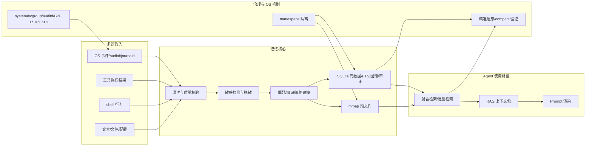

# MemGuardOS

MemGuardOS 是面向 **研究生操作系统开源创新大赛赛题 3：面向 Linux 的智能体记忆提取与精准遗忘机制** 的 Linux/openKylin 智能体记忆系统。

它提供一条本地可运行、可测试、可审计、可在 openKylin 复验的链路：从多源数据中提取偏好记忆与知识记忆，经过敏感治理和轻量化存储后，为 OS Agent 构建 RAG 上下文，并支持自然语言级精准遗忘。

`Python 3.9+` · `Linux/openKylin` · `mmap + SQLite FTS` · `CLI + daemon + Unix socket API` · `MIT License`

## 目录

- [项目定位](#项目定位)
- [当前状态](#当前状态)
- [核心能力](#核心能力)
- [系统架构](#系统架构)
- [快速开始](#快速开始)
- [openKylin 复验](#openkylin-复验)
- [评测与证据](#评测与证据)
- [项目结构](#项目结构)
- [正式提交材料](#正式提交材料)
- [准确边界](#准确边界)

## 项目定位

OS Agent 在 Linux 桌面和开发环境中会长期处理命令、文件、配置、日志、工具调用结果和用户偏好。普通聊天记录库无法回答三个关键问题：

1. 哪些信息应该沉淀为偏好或知识，哪些只是一次性上下文。
2. 检索增强生成前，怎样在 token 预算内返回可靠、已脱敏、可追溯的记忆。
3. 用户要求“忘掉某类信息”时，怎样定位候选、确认删除、清理索引并证明明文不可再检索。

MemGuardOS 围绕这些问题构建本地智能体记忆模块。上游 Agent 可以通过 CLI 或 Unix socket API 写入工具结果、查询记忆、批量检索、生成 RAG 上下文包，再交给本地或远程 LLM 生成回答；系统默认不依赖外部 LLM API，也不需要 GPU。

## 当前状态

| 类别 | 当前结果 |
|---|---:|
| 本地单元测试 | 47 passed |
| openKylin 单元测试证据 | 42 passed |
| 本地 1k 负载 P95 | 14.645 ms |
| openKylin 1k 负载 P95 | 76.182 ms |
| openKylin 10k 负载 P95 | 343.328 ms |
| openKylin 10k 负载 P99 | 432.702 ms |
| openKylin 10k RSS | 66116 KB |
| Recall@5 / 跨语言 Recall@5 | 1.0000 / 1.0000 |
| 敏感阻断 F1 / 脱敏 F1 / 标签 F1 | 1.0000 / 1.0000 / 1.0000 |
| 精准遗忘候选精确率 / 召回率 | 1.0000 / 1.0000 |
| 冲突处理正确率 | 1.0000 |

最新 openKylin 证据包位于 [docs/evidence/latest/](docs/evidence/latest/)。评测汇总见 [docs/测试报告.md](docs/测试报告.md) 和 [docs/评委证据包索引.md](docs/评委证据包索引.md)。

## 核心能力

| 能力域 | 已实现内容 | 主要入口 |
|---|---|---|
| 多源记忆接入 | 文本、文件、结构化配置、shell 行为、工具执行结果、OS 事件、auditd 日志 | `memctl ingest`、`ingest-config`、`ingest-history`、`ingest-tool-result`、`ingest-os-event` |
| 记忆建模 | 偏好记忆、知识记忆、敏感策略记忆；`working`、`session`、`long_term` 三层记忆 | `memguard/models.py`、`memguard/service.py` |
| 数据质量治理 | Unicode 标准化、空输入拒绝、低质量提示、结构化字段校验、质量分入审计 | `memguard/ingestion/quality.py` |
| 轻量化存储 | mmap 追加式段文件、SQLite 元数据、FTS、图谱边、审计哈希链 | `memguard/store/` |
| 混合检索 | SQLite FTS、稳定 hash-vector、图谱关联、跨语言技术词扩展、冲突处理 | `memguard/retrieval/` |
| RAG 上下文 | 检索、脱敏、排序、token 预算估算、上下文包和 provider-neutral prompt | `memctl build-context`、`memctl build-prompt` |
| 精准遗忘 | 自然语言候选、dry-run、确认删除、tombstone、FTS/图谱清理、compact、明文探针验证 | `memctl forget`、`memctl verify-forget` |
| 敏感治理 | PII、凭据、私钥、银行卡、中文地址、OS 高风险路径、自定义正则、自然语言敏感规则 | `memguard/sensitivity/` |
| 多会话隔离 | namespace 独立段文件、SQLite、敏感规则、审计链；systemd 模板服务配合 cgroup | `memctl --namespace`、`memguardd@.service` |
| OS 集成 | systemd、cgroup、journald、auditd、BPF LSM 可选强制拦截、UKUI/Peony 原生插件源码 | `scripts/`、`native/` |
| Agent API | 本地 Unix socket JSON API，支持 health、ingest、search、batch_search、build_context、forget、audit 等 | `memguard/api/server.py` |
| Kylin SDK 适配 | Kylin embedding/vector SDK 探测，embedding 可选重排后端，默认保留稳定 fallback | `memctl sdk-status`、`memguard/retrieval/kylin_sdk.py` |

## 系统架构



整体设计选择是“端侧稳定优先”：默认主链路不依赖云端 API、GPU 或重量级向量数据库；在 openKylin 环境存在 Kylin SDK 时启用探测和可选增强，在 SDK 不可用或超时时自动回退到稳定检索路径。

## 快速开始

### 1. 安装与测试

```powershell
cd D:\Luo_docs\竞赛\研创赛\memguardos
python -m pip install -e ".[dev]"
python -m pytest -q
python scripts/demo_smoke.py
```

### 2. 写入和检索记忆

```powershell
python -m memguard.cli.memctl ingest --text "以后回答 Linux 命令时直接给命令和风险提示。"
python -m memguard.cli.memctl ingest-config --file data/demo/user_config.json
python -m memguard.cli.memctl ingest-tool-result --file data/demo/tool_result_success.json
python -m memguard.cli.memctl search "Linux 命令回答偏好"
```

### 3. 为 Agent 构建 RAG 上下文

```powershell
python -m memguard.cli.memctl batch-search "任务规划 systemd cgroup" "工具调用 pytest journalctl" "结果生成 答辩证据"
python -m memguard.cli.memctl build-context "openKylin 服务内存限制" --top-k 5 --token-budget 1200
python -m memguard.cli.memctl build-prompt "openKylin 服务内存限制" --top-k 5 --token-budget 1200
```

### 4. 精准遗忘和审计

```powershell
python -m memguard.cli.memctl forget "忘掉 temporary project codename"
python -m memguard.cli.memctl forget "忘掉 temporary project codename" --yes --compact
python -m memguard.cli.memctl verify-forget "temporary project codename"
python -m memguard.cli.memctl verify-audit
```

### 5. 多会话隔离

```powershell
python -m memguard.cli.memctl --namespace demo-a ingest --text "demo-a 会话只保存 systemd MemoryMax 方案。"
python -m memguard.cli.memctl --namespace demo-b search MemoryMax
python -m memguard.cli.memctl --namespace demo-a namespace-status
```

## openKylin 复验

在 openKylin 虚拟机中：

```bash
cd ~/memguardos
source .venv/bin/activate
python -m pytest -q
bash scripts/openkylin_verify.sh
bash scripts/collect_openkylin_evidence.sh --with-10k
```

systemd/cgroup、auditd、SDK、UKUI、BPF LSM 常用验证入口：

```bash
sudo bash scripts/install_openkylin.sh "$(pwd)"
sudo systemctl start memguardd
systemctl show memguardd -p MemoryMax -p CPUQuotaPerSecUSec
python -m memguard.cli.memctl auditd-rules --format auditctl
python -m memguard.cli.memctl sdk-status --probe-embedding --probe-timeout 90
MEMGUARD_EMBEDDING_BACKEND=auto python -m memguard.cli.memctl search "openKylin 服务内存限制" --top-k 2
```

## 评测与证据

本地 1k 负载评测：

```bash
python -m memguard.eval.run_eval --latency-size 1000 --latency-queries 120 --output docs/eval_result.json --markdown docs/eval_report.md
```

openKylin 10k 规模评测：

```bash
python -m memguard.eval.run_eval --latency-size 10000 --latency-queries 150 --output docs/eval_result_openkylin_10k.json --markdown docs/eval_report_openkylin_10k.md
```

关键证据入口：

| 你要核查什么 | 推荐入口 |
|---|---|
| 赛题要求是否覆盖 | [docs/赛题符合性说明.md](docs/赛题符合性说明.md) |
| 功能、指标和 openKylin 结果 | [docs/测试报告.md](docs/测试报告.md) |
| 评委现场证据文件 | [docs/评委证据包索引.md](docs/评委证据包索引.md) |
| OS 机制实现 | [docs/操作系统机制说明.md](docs/操作系统机制说明.md) |
| Kylin SDK 适配 | [docs/麒麟SDK集成证据.md](docs/麒麟SDK集成证据.md) |
| 安全与精准遗忘 | [docs/安全设计说明书.md](docs/安全设计说明书.md) |

## 项目结构

```text
memguardos/
├── memguard/       # 核心 Python 包：接入、建模、存储、检索、遗忘、安全、OS 适配、API
├── scripts/        # 部署、验证、演示、证据采集、auditd/BPF/UKUI/Kylin SDK 脚本
├── native/         # BPF LSM、Peony 右键插件、UKUI 控制中心插件源码
├── tests/          # 核心功能、评测边界和回归测试
├── data/           # demo 输入、benchmark 样例和评测数据
├── docs/           # 正式中文文档、评测报告和 openKylin 证据包
├── pyproject.toml  # Python 包与开发依赖配置
└── LICENSE         # MIT License
```

完整工程仓库还包含 `.github/`、`.devcontainer/`、`Makefile`、贡献指南、变更日志、打包脚本和自检脚本。这些材料用于协作、CI、备份和工程维护，不作为正式竞赛作品主体。

## 正式提交材料

正式竞赛提交包由完整工程仓库生成：

```bash
python scripts/package_submission.py
```

生成结果包括：

```text
dist/memguardos_competition_submission_<时间戳>.zip
dist/memguardos_competition_submission_<时间戳>_manifest.json
dist/memguardos_full_repository_<时间戳>.zip
dist/memguardos_full_repository_<时间戳>_manifest.json
```

竞赛平台优先提交 `memguardos_competition_submission_*.zip`。该包包含源码、部署验证脚本、测试数据、正式中文文档、评测报告和 openKylin 证据；不包含 GitHub 协作模板、过程追踪表、临时缓存、虚拟环境、个人笔记或仅用于工程自检的脚本。边界说明见 [docs/正式提交材料说明.md](docs/正式提交材料说明.md)。

正式评审建议按以下顺序阅读：

1. [docs/项目介绍总览.md](docs/项目介绍总览.md)
2. [docs/赛题符合性说明.md](docs/赛题符合性说明.md)
3. [docs/概要设计说明书.md](docs/概要设计说明书.md) 和 [docs/详细设计说明书.md](docs/详细设计说明书.md)
4. [docs/部署手册.md](docs/部署手册.md) 和 [docs/用户手册.md](docs/用户手册.md)
5. [docs/测试报告.md](docs/测试报告.md) 和 [docs/评委证据包索引.md](docs/评委证据包索引.md)
6. [docs/答辩提纲.md](docs/答辩提纲.md) 和 [docs/演示视频脚本.md](docs/演示视频脚本.md)

## 准确边界

- Kylin embedding SDK：已完成真实向量探针和可选重排检索证据；默认主路径仍保留 FTS/hash/graph fallback。
- BPF LSM：已在 openKylin 对安全测试文件完成强制拒绝验证；默认不拦截 `/etc/shadow`、SSH、sudo 或 PAM 链路。
- UKUI：Peony/UKUI 控制中心插件源码已构建 `.so`；UI 可见性以目标系统安装验证为准。
- 用户行为：支持 shell 行为、工具结果、OS 事件和 auditd 事件；不宣称全量桌面行为捕获。
- 外部 LLM：默认不依赖外部 API；只有显式选择 provider 时才调用本地命令或兼容远程端点。

## 许可证

MemGuardOS 使用 MIT License，见 [LICENSE](LICENSE)。
