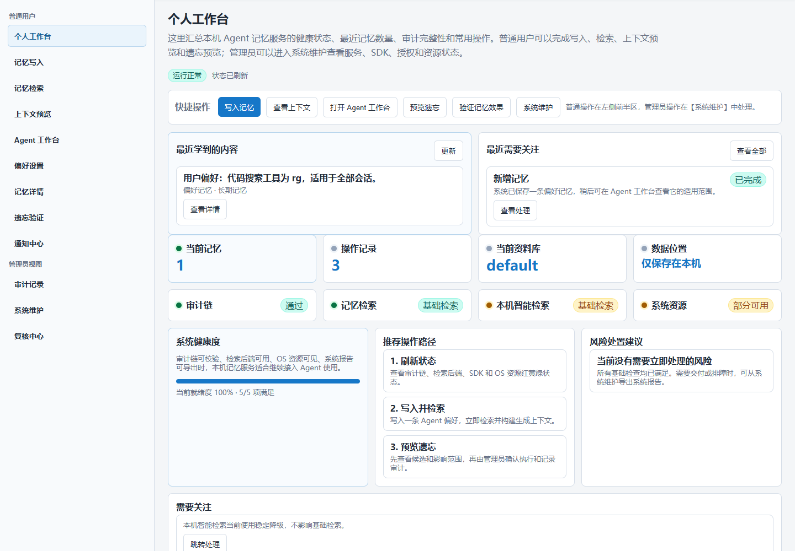
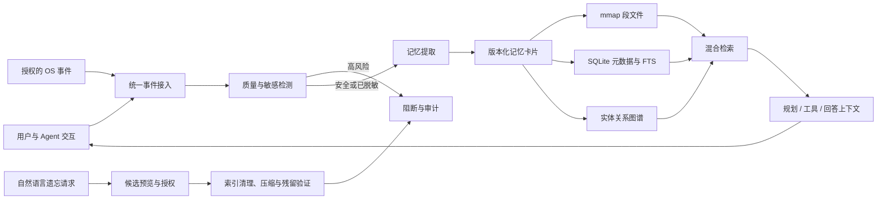

# MemGuardOS

面向 openKylin 与 Linux OS Agent 的本地记忆提取、上下文增强和精准遗忘系统。

[](https://github.com/Alexd-star/memguardos/actions/workflows/ci.yml)
[](https://www.python.org/)
[](LICENSE)

MemGuardOS 把用户与 Agent 的消息、纠正、工具调用和工具结果转化为可追溯记忆，在 Agent 规划、工具选择和回答生成前按需提供上下文；用户还可以先预览影响范围，再精准遗忘指定主题、偏好、时间段或来源。系统默认在本机运行，不要求 GPU，也不把原始记忆上传到云端。



## 为什么需要它

OS Agent 会反复处理命令、文件、工具和系统状态。只有聊天记录时，Agent 很难稳定区分长期偏好、一次性指令、工具失败经验和敏感数据，也很难在用户提出“忘掉上周关于某项目的工具偏好”时只删除目标信息。

MemGuardOS 提供一条完整的本地记忆生命周期：

1. 接收用户消息、Agent 消息、反馈、工具调用、工具结果和授权的 OS 事件。
2. 提取偏好、知识、程序性经验和安全策略，并保存来源、置信度与有效期。
3. 在写入前阻断凭据等高风险内容，对可保留的个人信息执行脱敏。
4. 使用 FTS、稳定向量、图谱和可选 Kylin SDK 进行混合检索。
5. 在任务规划、工具选择和结果生成三个阶段向 Agent 注入不同上下文。
6. 通过预览、确认、墓碑、索引清理、段文件压缩和明文探针完成精准遗忘。
7. 用哈希链审计、systemd、cgroup、auditd、BPF LSM、UKUI 和 Peony 提供 OS 级治理能力。

## 核心能力

| 能力 | 对用户的价值 | 主要入口 |
|---|---|---|
| 交互记忆提取 | 自动沉淀用户纠正、工具偏好和成功/失败经验 | `memguard remember`、Agent 事件 API |
| 分阶段上下文 | 只把当前任务需要的记忆交给 Agent，减少重复解释 | `memguard context`、Unix socket API |
| 精准遗忘 | 先看候选和影响，再确认删除，并验证残留 | `memguard forget`、Web 工作台 |
| 敏感治理 | 阻断凭据，脱敏个人信息，记录风险处置 | 写入链、Peony 文件扫描 |
| openKylin 原生集成 | 在系统设置、托盘和文件右键菜单中使用 | UKUI、Peony、系统托盘 |
| 可审计运行 | 检查来源、版本、系统状态和审计完整性 | `memctl verify-audit`、管理员页 |

## 快速开始

### 1. 安装开发版

```bash
git clone https://github.com/Alexd-star/memguardos.git
cd memguardos
python3 -m venv .venv
source .venv/bin/activate
python -m pip install -U pip
python -m pip install -e .
```

Windows PowerShell 使用 `.venv\Scripts\Activate.ps1` 激活环境。完整开发环境使用 `python -m pip install -e ".[dev,security]"`。

### 2. 体验完整记忆闭环

```bash
memguard status
memguard remember "以后查找代码时优先使用 rg，并简要说明命令风险。"
memguard search "搜索代码工具"
memguard context "在项目中定位配置加载逻辑"
memguard forget "忘掉搜索工具偏好"
```

`forget` 默认只展示将受影响的记忆；确认删除时按命令提示执行。需要连续操作时可进入交互工作台：

```bash
memguard shell
```

### 3. 打开本地工作台

```bash
memctl web --host 127.0.0.1 --port 8765
```

浏览器访问 `http://127.0.0.1:8765`。工作台用于记忆写入、检索、上下文预览、遗忘、通知和系统维护；它默认只监听本机地址，不应直接暴露到公网。

## openKylin 安装

源码部署：

```bash
sudo bash scripts/install_openkylin.sh "$(pwd)"
systemctl status memguardd --no-pager
memguard status
```

正式交付提供五个职责分离的 Debian 包：

| 包 | 内容 |
|---|---|
| `memguardos-core` | 核心服务、CLI、Unix socket API |
| `memguardos-ukui` | UKUI 设置插件、Peony 右键、托盘与通知 |
| `memguardos-agent-bridge` | Agent 适配器和受限 systemd bridge |
| `memguardos-doc` | 离线文档 |
| `memguardos` | 安装全部组件的聚合包 |

构建和生命周期验证见 [安装部署](docs/installation.md)。桌面包可单独卸载，核心服务和用户数据不会随之删除。

## 接入 Agent

MemGuardOS 不要求 Agent 使用特定界面。外部 Agent 可以通过标准事件 JSON、Python API、JSONL 回放或 Unix socket 接入。已完成端到端验证的第一方适配器是 OpenHands。

```bash
memguard shell
```

进入工作台后使用 `/run <自然语言任务>` 发起真实 Agent 任务。适配器在任务规划、工具选择和结果生成前分别构建上下文，并把用户消息、工具调用和执行结果回写为标准事件。未安装 OpenHands 或未配置模型时，命令会明确说明降级状态，不会把事件回放冒充真实 Agent 运行。

接入协议、事件格式和 OpenHands 配置见 [Agent 接入](docs/agent-integration.md) 与 [接口参考](docs/api.md)。

## 系统架构



核心存储路径保持离线可复现；Kylin embedding SDK 是带延迟预算、预热、缓存和透明降级的可选重排后端。详细设计见 [系统架构](docs/architecture.md)。

## 验证结果

下表只列出仓库中有原始结果文件的代表性数据，不把不同实验口径混合计算。

| 验证层 | 数据与环境 | 代表性结果 |
|---|---|---|
| 通用功能 | 217 条自建可复现用例 | Recall@5、跨语言 Recall@5、敏感阻断 F1、遗忘候选精确率与召回率均为 1.0000 |
| Agent 交互专项 | 200 条，其中 60 条匿名化真实风格、140 条合成 | 跨会话遵循率 1.0000，敏感泄漏率 0，P95 113.966 ms |
| 真实 OpenHands | 基础 12 次、扩展 8 次、留出 8 次 | 28 次运行均形成上下文、事件和结果记录 |
| openKylin 10k 负载 | 10,000 条记忆、150 次查询 | P95 10.105 ms，P99 75.255 ms |
| 检索 v2 | openKylin 三轮、1,000 条、6 worker | 三轮 Recall@5 均为 1.0000，门禁通过 |

这些结果证明相应数据集和环境中的功能、延迟与回归稳定性，不等同于对所有模型、任务和硬件的普遍保证。完整实验方法、消融、失败边界和原始文件入口见 [测试与评测](docs/testing.md) 与 [证据索引](docs/evidence/README.md)。

## 项目结构

```text
memguard/                  Python 核心、CLI、服务、Agent 适配与 Web 工作台
native/                    BPF LSM、UKUI、Peony 和托盘原生组件
packaging/                 Debian、desktop、Polkit 与系统集成资产
scripts/                   安装、构建、评测、证据采集和维护脚本
data/                      演示数据与可复现评测数据集
tests/                     单元、集成、安全、桌面与交付测试
docs/                      面向用户和开发者的正式文档与精选证据
```

## 文档

- [文档导航](docs/README.md)
- [安装部署](docs/installation.md)
- [用户指南](docs/user-guide.md)
- [Agent 接入](docs/agent-integration.md)
- [系统架构](docs/architecture.md)
- [接口参考](docs/api.md)
- [开发者指南](docs/developer-guide.md)
- [安全与遗忘边界](docs/security.md)
- [测试与评测](docs/testing.md)
- [赛题符合性](docs/competition.md)

## 安全边界

MemGuardOS 的精准遗忘覆盖它管理的事件、元数据、FTS、图谱、缓存和追加式段文件。它不会自动擦除外部 Agent 会话、模型服务日志、shell history、备份、虚拟机快照或存储介质的物理残留；这些副本必须由对应系统的生命周期策略处理。BPF LSM 提供路径策略的强制拦截，不宣称在内核态识别任意文件内容。

发现安全问题时请按 [SECURITY.md](SECURITY.md) 私下报告，不要在公开 Issue 中提交真实凭据或个人信息。

## 开源与来源

项目采用 [MIT License](LICENSE)。贡献方式见 [CONTRIBUTING.md](CONTRIBUTING.md)。

MemGuardOS 起源于第三届中国研究生操作系统开源创新大赛“面向 openKylin 的智能体记忆提取与精准遗忘机制”赛题，现按可独立安装、可接入和可审计的开源项目维护。赛题要求与实现映射见 [赛题符合性](docs/competition.md)。
