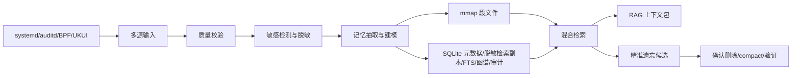

# 05 项目架构说明

本文档说明 MemGuardOS 的总体架构、数据流、模块关系和运行形态。更细的实现说明见 [概要设计说明书.md](概要设计说明书.md) 和 [详细设计说明书.md](详细设计说明书.md)。

## 1. 总体架构

MemGuardOS 采用分层架构：输入接入层负责收集文本、文件、配置、行为、工具结果和 OS 事件；治理抽取层负责质量校验、敏感检测、语义抽取和实体关系抽取；存储索引层负责 mmap 段文件、SQLite 元数据与脱敏检索副本、FTS、图谱边、版本和审计链；检索生成层负责混合检索、冲突处理、RAG 上下文构建和 prompt 渲染；运维集成层负责 CLI、daemon、Unix socket API、Web 控制台和 openKylin OS 机制。

## 2. 数据流

一条记忆从输入到使用通常经历以下流程。用户或 Agent 通过 CLI/API/Web 写入信息，系统先做文本标准化和质量评估，再做敏感检测。若命中私钥、凭据等高风险信息，系统会阻断写入；若是手机号、地址、银行卡等可脱敏信息，系统会保存脱敏文本并记录敏感标签。随后抽取器判断记忆类型、标签、实体、关系和程序性结构，存储层写入段文件和索引，审计层记录哈希链。

检索时，系统根据查询文本执行 FTS、hash-vector、图谱关联和冲突处理，并过滤已删除、已失效或被更新覆盖的历史版本。构建 RAG 上下文时，系统会再次执行敏感治理、token 预算裁剪和来源解释，确保交给 LLM 的不是未经审查的原始文本。

## 3. 存储架构

存储层采用轻量化设计。mmap 追加式段文件保存记忆载荷，SQLite 保存元数据、脱敏后的检索内容副本、FTS 索引、图谱边、版本窗口和审计链。这种设计避免引入重型数据库服务，适合端侧部署和 openKylin 虚拟机复验。精准遗忘时，SQLite 先清空被遗忘记录的检索副本并标记删除，compact 再重写段文件，清理已删除明文。

## 4. 检索架构

检索层不是单一向量检索。默认路径结合 SQLite FTS、稳定 hash-vector、实体关系图谱、跨语言技术词扩展和冲突处理。Kylin embedding SDK 可作为可选增强路径参与重排，但默认保留稳定 fallback。层次图谱检索将结果分为摘要层、实体关系层和原文 chunk 层，便于解释“为什么这条记忆被选中”。

## 5. OS 集成架构

项目通过 systemd 提供 daemon 和 namespace 模板服务，通过 cgroup 展示资源控制，通过 auditd 捕获敏感路径访问事件，通过 journald 输出服务日志，通过 BPF LSM 对安全测试路径执行强制拒绝，通过 Peony/UKUI 提供桌面入口和文件扫描闭环。这些能力共同体现“面向 Linux 的智能体记忆系统”而不是普通应用层文本库。

## 6. 运行形态

项目支持本地开发运行、openKylin 服务化运行、`.deb` 安装运行和正式竞赛提交包复验。Web 控制台用于本机运维和评审演示，Unix socket API 用于本地 Agent 集成，CLI 用于人工操作和脚本化复验。不同运行形态共享同一套核心 service 和存储逻辑。
