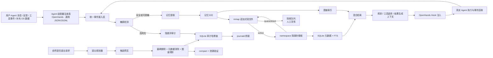

# MemGuardOS 总体设计

## 1. 项目定位

MemGuardOS 是面向 Linux/openKylin OS Agent 的记忆基础设施，解决三个核心问题：

1. 智能体如何从用户与 Agent 的消息、反馈、工具调用、工具结果及补充 OS 数据中提取有价值记忆？
2. 这些记忆如何在 Linux 机制下被检索、版本化、审计和资源约束？
3. 敏感或过期记忆如何以可审计、可验证、不可逆的方式精准遗忘？

MemGuardOS 不是通用 RAG demo，而是把智能体记忆当作 OS 管理资源，核心能力包括：

- 多源记忆接入；
- 可解释混合语义抽取；
- working/session/long_term 记忆层级；
- 追加式版本化存储；
- 图谱化知识记忆；
- 带 OS 上下文的敏感检测；
- 自然语言精准遗忘；
- 审计哈希链验证；
- openKylin/namespace/systemd/auditd/cgroup/BPF LSM/UKUI/Web 控制台验证路径。
- OpenHands 真实 Agent 适配、跨会话习惯复用和交互范围精准遗忘。

## 2. 总体架构



## 3. 核心组件

| 组件 | 职责 | 当前证据 |
|---|---|---|
| CLI `memctl` | 用户与演示入口 | `ingest/search/forget/versions/rollback/doctor/...` |
| Web 控制台 | 本地评审和演示入口 | `memctl web`、`memguard/web/dashboard.py` |
| 记忆卡片 | 统一记忆 schema | `memguard/models.py` |
| 混合抽取器 | 偏好/知识/安全策略抽取和可解释信号 | `memguard/extraction/semantic.py` |
| 敏感检测器 | PII/凭据/自定义模式/OS 路径检测 | `memguard/sensitivity` |
| 治理状态机 | 约束隔离、替代、来源失效、拒绝和遗忘的合法流转 | `memguard/governance/state.py`、SQLite 写边界 |
| 追加式存储 | 版本段文件、mmap 读、compact 清除 | `memguard/store/mmap_store.py` |
| SQLite 元数据 | 元数据、FTS、审计、图谱表 | `memguard/store/sqlite_meta.py` |
| 混合检索器 | 词法 + 轻量向量式 + 图谱扩展 | `memguard/retrieval/hybrid.py` |
| 图谱记忆 | 实体/关系抽取和关联检索 | `memguard/extraction/entity.py` |
| 遗忘规划器 | 自然语言候选选择 | `memguard/forgetting/planner.py` |
| 会话记忆巩固器 | 按证据、可信度、敏感等级和版本快照生成可复核的长期晋级计划 | `MemGuardService.build_consolidation_plan`、`apply_consolidation_plan` |
| OS Guard | namespace、cgroup、journald、auditd、OS 事件 | `memguard/config.py`、`memguard/os_guard` |
| 评测模块 | 指标、延迟负载、报告 | `memguard/eval/run_eval.py` |
| Agent 适配层 | 能力注册、通用 JSON/JSONL 事件映射、OpenHands 事件规范化、分阶段上下文编排、执行前行动契约、执行后反馈账本、习惯聚合与真实 runner | `memguard/integrations/adapter_registry.py`、`memguard/integrations/context_compaction.py`、`memguard/integrations/action_feedback.py`、`memguard/integrations/` |
| Agent bridge | systemd 受限队列任务执行 | `scripts/memguard_agent_bridge.py`、`memguard-agent@.service` |

## 4. 记忆生命周期

1. **接入**：各类 Agent 先由注册表中的适配器映射为统一事件；OpenHands 用户消息、Agent 消息、反馈、工具调用和工具结果自动进入事件链，其他 Agent 可以通过通用 JSON/JSONL 契约接入；文本、文件、配置、shell 与 OS 事件作为补充来源。
2. **抽取**：内容被分为偏好、知识或敏感策略，并记录抽取方法、信号和置信度。
3. **敏感检测**：检查敏感模式和 OS 来源路径。
4. **存储**：安全记忆写入当前 namespace 下的追加式段文件和 SQLite 元数据。
5. **结构化**：抽取实体和关系，写入图谱表。
6. **检索**：授权范围内的 FTS、可选独立语义候选与图谱扩展，经 RRF 融合并按阶段构建上下文。
7. **更新/回滚**：更新和回滚都追加新版本，不覆盖历史。
8. **遗忘**：写入 tombstone、清理索引、compact、验证明文无泄漏。
9. **审计**：关键事件进入哈希链审计日志，并可镜像到 journald。
10. **跨会话复用**：新会话分别在任务规划、工具选择和结果生成阶段读取相关偏好与知识。
11. **执行前行动核验**：工具调用提交给 Agent runtime 前，依据当前记忆版本和作用域生成行动契约，记录允许、改用、确认或拒绝的结果。
12. **会话记忆巩固**：会话结束或需要整理时，系统按证据类型、命中次数、可信度、敏感等级和治理状态生成版本化计划；用户只需审核建议晋级项，未达到证据门槛的内容继续留在会话层，工作记忆进入清理复核队列。
13. **强化与衰减**：长期记忆根据检索次数、最近使用时间、重要性和置信度计算健康度；冷记忆先进入可解释的降级计划，确认后可逆地回到会话层，用户主动遗忘仍走完整删除验证链路。
14. **上下文编排**：记忆通过阶段策略和 token 预算进入 Agent。流程约束在规划、工具选择阶段保留完整步骤；工具偏好保留可执行指令、来源和版本；普通知识在规划或预算紧张时压缩为摘要或证据。每条已选记忆的表示方式、压缩原因和预计节省量都进入上下文收据，方便复核“为什么带入、带了多少、是否丢失了行动约束”。
15. **行动结果闭环**：执行前契约绑定记忆版本，外部 Agent 完成工具调用后通过统一接口回写退出状态、实际工具和任务状态。系统按记忆证据逐条记录成功、失败、偏离、拦截或未知结果，以幂等键防止重试重复计数；命令正文只在调用方边界内使用，账本只保存摘要哈希。遗忘时同步清理账本，旧上下文或旧版本不能继续强化已变化的记忆。

对外的生命周期视图将一条记忆组织为四部分：记忆原子描述当前内容、类型、范围和版本；情节视图按 Agent、会话、项目与任务归集形成过程；支持证据标明来源事件及原文跨度；操作记录连接写入、更新、使用与遗忘的审计信息。四部分来自现有权威记录和证据关系，统一用于 CLI、API 与 Web 详情展示。查看时可通过 `memctl lifecycle <记忆编号>` 追溯具体记录，通过 `memctl lifecycle --overview` 查看当前记忆空间的覆盖情况。

### 4.1 可扩展 Agent 接入边界

Agent 接入层采用“适配器负责翻译，服务负责治理”的边界。`AgentAdapterRegistry` 只登记适配器名称、版本、可产生的事件类型、支持的上下文阶段和检查点能力；它不执行外部代码，也不授予调用方绕过敏感检测、项目范围或遗忘验证的权限。当前注册两类入口：OpenHands SDK 适配器负责将 SDK 对象转换为事件，通用 `generic-json` 适配器负责将不同 Agent 输出的 JSON/JSONL 事件映射为同一协议。

通用事件至少包含 Agent 名称与版本、会话编号、轮次编号、序号、事件类型和角色；消息、工具调用、工具结果、反馈、任务完成、策略判定和错误都使用明确类型表达。适配器只接受有限的类型别名，无法识别的事件直接拒绝，不把未知内容默认为用户消息；整批 JSONL 在转换完成后才提交，因此一条格式错误的记录不会留下半个会话。规范化后仍由服务统一完成递归参数脱敏、敏感阻断、偏好提取、幂等去重、审计和遗忘关联。

接入方可先查询 `agent_adapters` 能力目录，再使用 `ingest_agent_events` 或 `memctl agent ingest-adapted-session` 写入事件。上下文请求继续沿用规划、工具选择和回答生成三个阶段，适配器不直接拼接 Prompt。这样，新增 Agent 的工作量集中在事件映射和检查点回调，长期记忆、跨会话复用和精准遗忘仍共享同一套可验证内核。

SQLite 中已提交的版本决定当前可见状态。段文件中提前追加但尚未提交的版本不会进入生命周期历史，历史沿父版本链展开并去重。遗忘后，来源摘要和支持证据进行脱敏；验证同时检查正文、事件载荷、索引、图关系、缓存和事实核对队列，客户端根据实际验证状态显示完成或待检查。

事实更新按主体、属性、项目与保存范围查找当前记录。用户明确纠正时生成新版本；新旧事实相冲突且缺少明确替换意图时进入事实核对队列，保存候选编号、版本快照及来源跨度。用户可以保留原值，或接受新值并生成版本。创建核对记录和提交更新时均在写事务内检查候选；接受新值时，记忆版本、来源关系、核对状态与提交审计共同提交，发生中断后沿暂存写入恢复。候选发生变化或另一项决定已经生效时，取消过期写入并要求重新核对。遗忘目标记忆会清理核对队列中引用的正文、主体、项目、来源和候选信息；遗忘来源事件也会关闭相应核对记录，防止被撤回的内容再次生效。

### 4.2 从记忆到行动：执行前行动契约

仅把相关记忆放进上下文，不能保证 Agent 真正按记忆行动。MemGuardOS 在工具选择阶段增加 provider-neutral 的 `preflight_agent_action` 契约：调用方提交任务、工具名称和拟执行参数，服务重新构建当前作用域的工具选择上下文，依据所选记忆和最新版本返回 `allow`、`redirect`、`confirm` 或 `deny`。这个接口只做判定，不执行外部命令，因此可以由 OpenHands 或其他 Agent 适配器在各自的工具执行前统一接入。

行动判定保留记忆编号、版本编号、上下文收据指纹、作用域和判定原因。代码搜索偏好冲突时返回可修正的替代工具建议；高风险确认策略命中时要求用户确认；已知破坏性命令直接拒绝；没有适用记忆时允许正常执行。判定使用当前版本和项目边界，旧上下文、跨项目偏好或已遗忘记忆不能继续影响行动。对应接口同时开放给 Unix socket、CLI `memctl agent preflight-action` 和 Web/API 适配层，形成从“检索记忆”到“约束工具行动”的可验证闭环。

### 4.3 阶段感知上下文编排：把记忆预算交给任务阶段

检索结果并不等于适合直接拼接到提示词的上下文。规划、工具选择和回答生成面对的决策不同：规划需要目标、约束和项目事实，工具阶段需要可执行的命令偏好与已验证步骤，回答阶段更关心表达习惯和能够支撑结论的证据。如果三类内容始终以同样长度进入上下文，记忆规模增长后会出现有效信息被低价值正文挤出的情况。

MemGuardOS 在检索筛选之后增加 provider-neutral 的表示层。自适应策略为每条候选选择 `full`、`evidence` 或 `summary` 三种表示：验证过的流程和工具选择阶段的行动约束保留完整步骤；偏好保留可执行指令、来源和当前版本；普通知识只保留面向当前阶段的摘要或带来源、置信度和版本的证据行。敏感等级较高的记录不会因为预算充足而扩大表示范围，仍沿用写入和上下文阶段的脱敏结果。

表示选择是确定性的，不依赖外部模型。服务会尝试当前阶段的首选表示，再在剩余预算不足时降级到更紧凑的证据或摘要表示；完全无法满足字符和 token 预算的候选进入过滤清单，而不是被静默截断。上下文结果同时返回表示分布、压缩原因、原始完整表示的估算 token 数和节省量。`memguardos-context-receipt-v1` 将这些字段与记忆版本映射一并指纹化；记忆更新、偏好覆盖或遗忘后，运行时版本核验会要求重新构建上下文，表示策略也可以通过收据追溯。

这一设计把“检索相关性”和“上下文可用性”分成两个可解释阶段，也吸收了近期长期记忆工程中对分层存储、巩固、强化和资源预算的实践。它不改变记忆的权威正文，压缩只发生在本轮 Agent 上下文装配层，后续仍可通过生命周期视图和来源证据追溯完整记录。

### 4.3.1 行动结果反馈：让“记住”接受真实执行检验

仅有工具选择前的 `redirect` 结果，仍只能说明系统发现了偏好冲突，不能说明 Agent 最终是否采用了建议。MemGuardOS 将执行后的反馈定义为独立的证据账本：适配器完成外部工具调用后提交预检结果、实际工具输入和退出状态，服务先核对上下文收据及每条证据记忆的当前版本，再将结果归类为 `success`、`failure`、`deviation`、`blocked` 或 `unknown`。其中，成功且遵循当前偏好的结果才具有强化意义；命令虽然成功但偏离偏好的情况单独计为 `deviation`，不会反向污染偏好提取。

账本按“记忆编号 + 版本编号 + 幂等键”记录与记忆的对应关系，不保存命令正文或工具输出，只保留摘要哈希、工具名称、退出码、作用域和上下文指纹。这样既能够在生命周期视图中回答“哪条记忆实际影响过行动、结果如何”，又不会把工具参数再次复制进长期记忆。网络重试、进程重启或适配器重复提交时，唯一约束保证一次行动只计数一次。

行动反馈还参与后续维护，但不越过治理边界直接生成新偏好。成功证据可以保护一条冷记忆免于被可逆衰减；失败、偏离和未知结果继续保持观察；当记忆被更新或精准遗忘时，旧收据不能再写入，已受管的行动账本也随记忆一并清理。由此，检索、决策、执行、反馈和遗忘在同一版本链上闭合，演示与评测可以区分“系统给过建议”和“Agent 实际遵循并获得成功结果”。

### 4.4 治理状态机：让“可用”成为受约束的状态

记忆是否能够进入检索和 Agent 上下文，不由某个调用方单独修改一个字符串决定，而由治理状态、可信度、时间有效性和作用域共同决定。当前状态机把记忆分为 `active`、`quarantined`、`superseded`、`source_invalidated`、`rejected` 和 `forgotten` 六类：新内容通过检测后进入 `active`，可疑来源进入隔离；偏好更新会使旧版本变为 `superseded`，来源变化会递归使派生经验变为 `source_invalidated`，人工复核拒绝进入 `rejected`，用户遗忘最终写入不可恢复的 `forgotten` 墓碑。

状态转换由 `memguard/governance/state.py` 统一声明并在 SQLite 写边界校验。普通元数据更新不允许把失效、替代或已遗忘的记录直接恢复为可用状态；隔离内容只有在带有父版本校验的 `governance_approve` 新版本提交时才能重新进入检索。这样，审批不是覆盖原记录，而是留下“原候选、审批人、理由、父版本和新版本”的完整链路。`source_invalidated` 和 `superseded` 也不会通过一次字段修改重新激活，必须重新验证或产生新的记忆版本。

这一层把抽取、敏感治理、事实冲突、派生依赖和精准遗忘连接成同一条生命周期约束。API 可通过 `governance_states` 查询状态目录，CLI 可运行 `memctl governance states` 查看合法流转；检索始终只选择当前有效的 `active` 记录，遗忘流程则通过专用墓碑路径处理正文、索引、图谱、缓存、事件证据和事实核对队列。状态机本身不替代审计，而是为审计记录提供稳定的事件语义，使控制台能够解释“为什么这条记忆现在不可用”。

### 4.5 会话记忆巩固：让短期经验经过审核再进入长期记忆

会话层承载的是刚刚发生的工作过程，其中既有可以反复复用的偏好和流程，也有只对当前任务成立的临时事实。若把所有会话内容直接提升为长期记忆，记忆空间会快速积累噪声，错误结论也会获得跨会话的持续影响。MemGuardOS 因此把“短期记忆转长期记忆”实现为一个可审查的巩固阶段，而不是一次无条件的层级切换。

`build_consolidation_plan` 以当前 SQLite 已提交版本为权威，为每条会话记忆保存记忆编号、版本编号、类型、来源、命中次数、置信度、重要性和敏感等级，并给出三类处理建议。明确的用户偏好、经过验证的程序性经验以及具备独立检索证据的知识可以进入 `promote` 候选；尚未形成重复证据的知识继续 `retain_session`；工作层内容进入 `evict_review`，等待任务边界结束或人工复核。高敏感、非 active、已删除或可信等级不足的记录不会因为命中一次就被提升。

巩固计划带有稳定的 `plan_id` 和期望版本映射。用户在 Web、API 或 CLI 中审核后，可以只选择其中一部分执行；提交前服务再次比较候选当前版本，若原记忆已经更新、失效或遗忘，旧计划会被拒绝，要求重新生成。确认后，系统沿既有版本链追加长期版本，保留来源和审计记录，未选择的内容继续留在会话层。这个设计把抽取、强化、人工审核、版本并发控制和后续遗忘放进同一条治理路径，也为后续接入时间衰减、到期回收和自动化巩固策略留下稳定接口。

这一设计吸收了近期记忆评测与工程架构中对“检索、测试时学习、长期理解、选择性遗忘”以及“抽取、巩固、强化、衰减、删除”完整生命周期的强调。具体参考 [MemoryAgentBench](https://arxiv.org/abs/2507.05257)、[LongMemEval-V2](https://arxiv.org/abs/2605.12493) 和 [Microsoft 多智能体长期记忆架构](https://github.com/microsoft/multi-agent-reference-architecture/blob/main/docs/memory/Long-Term-Memory.md)，并结合 openKylin 本地部署的敏感治理、版本审计和端侧资源边界落地为可复核的计划接口。

### 4.6 强化与可逆衰减：让记忆空间保持新鲜

长期记忆的价值不能由写入时间单独决定。每次真正进入上下文的记忆都会留下检索命中和最近使用时间，系统将这两项信号与重要性、置信度组合为健康度：访问频率使用对数归一化，最近使用采用指数衰减，重要性和置信度保持独立权重。这样，偶尔被使用但长期稳定的知识不会被简单的次数排序淹没，明确偏好也不会因为短期未访问而悄然消失。

`build_decay_plan` 只扫描当前有效的长期记忆，并输出健康度、年龄、命中次数、最近活动时间和推荐动作。高敏感记忆、明确偏好、具有强化证据的记忆和治理状态异常的记录分别进入保护或人工复核，不会被被动策略直接降级。只有超过观察周期、没有检索命中且健康度低于门槛的记录，才进入 `demote_to_session` 候选。

衰减计划采用与巩固计划相同的版本快照和完整性校验。用户可以先查看候选和原因，再选择部分记录降级；服务提交前重新读取当前版本并再次计算策略，记忆若已被更新、检索强化或遗忘，旧计划立即失效。确认降级会追加一个新的 session 版本，而不是删除原记录，因此后续任务再次使用它时仍可以通过巩固流程恢复到长期层。真正的永久删除只由用户精准遗忘、敏感违规清理或明确的保留策略触发。

### 4.7 价值感知的记忆预算：把空间、风险和收益放在同一张决策表

长期记忆数量增长后，仅按年龄或命中次数做衰减仍然不够：一条内容很长、很少被使用的普通知识，可能比一条短小但持续帮助 Agent 完成工具调用的经验更值得优先降级。MemGuardOS 在维护阶段增加 `build_memory_budget_plan`，对每条有效长期记忆计算重要性、置信度、来源信任、最近使用、检索频率和真实行动成功等收益信号，同时计算敏感等级、治理状态、失败与偏离结果等风险信号，再除以估算的持久化字节数，得到可解释的 `value_per_byte`。

预算计划只把普通长期记忆列为可逆降级候选。显式偏好、高敏感内容和治理状态异常记录始终进入 `retain_protected`，不会因为空间目标自动移动；其余候选按单位成本的净价值排序，直到长期层的估算占用达到目标或已经没有可安全处理的记录。估算值用于稳定比较和计划复核，并不冒充文件系统精确计费，因此计划结果同时给出当前占用、目标占用、预计回收字节、保护数量和目标是否可达。

计划采用与巩固、衰减相同的版本快照、完整性哈希和确认语义。提交前服务重新读取全部候选的版本与估算大小，并再次计算所选记录的风险策略；记忆已更新、被遗忘或变成受保护状态时，旧计划直接失效。确认后追加新的 session 版本，保留正文、来源和审计链，后续仍可经巩固流程恢复到长期层。CLI、Unix socket API、Web 管理入口和 openKylin 隔离证据使用同一服务实现，避免“展示层有预算、真实存储层没有治理”的断裂。

### 4.8 动作结果反哺：从“被注入”到“确实有用”

仅记录一条记忆是否进入上下文，无法说明它是否帮助 Agent 完成了正确动作。MemGuardOS 因此把执行前的行动契约与执行后的结果账本连接起来：适配器在工具调用前提交任务、工具参数、作用域和上下文收据，外部 Agent 完成调用后回传退出码或任务状态。系统只保存成功、失败、偏离、拦截和未知等结构化结果，以及命令摘要哈希，不保存命令正文和工具输出。

`agent_action_impact_report` 在此基础上按记忆编号聚合真实结果，并按 Agent、项目和任务类型建立同类观察组。报告同时给出执行次数、成功率、遵循率、失败与偏离风险，以及 Wilson 95% 成功下界和小样本证据系数。样本较少时即使表面成功率很高，也只会进入“继续观察”；连续成功且下界稳定后才进入“保留并强化”，失败或工具偏离较多的记忆进入人工复核。这样，记忆生命周期获得了来自实际行为的质量信号，避免把“系统提供过建议”误判为“Agent 已经采用并取得效果”。

报告中的同类差值是观察性比较，用于发现值得复核的记忆，不被包装成未经控制变量的因果结论。治理动作仍由巩固、衰减和预算计划负责，质量报告只提供可审计的决策依据；这使评测、运行维护和生命周期修改保持清晰边界，也为 Mem2ActBench 一类关注工具选择与参数落地的任务提供统一接口。

检索接口共享项目和会话条件。指定项目时可使用该项目与全局记忆，会话记忆还需匹配所属会话；这些条件先于候选数量限制执行，覆盖词法检索、向量候选、图检索、关联查询和批量上下文构建。管理查询可以省略项目字段查看跨项目内容，Agent 接入应传入当前项目目录。参数约定和示例见[接口文档](api.md)。

OpenHands 上下文快照同时绑定 namespace、项目、会话、Agent 与任务类型。检查点以只读事务核对所选记忆的当前版本、状态和作用域，并对所有适用偏好候选及其来源顺序生成签名。因此，新加入的覆盖偏好即使没有修改旧记录，也会使旧上下文失效。检查失败时停止当前任务并要求重新开始，新的上下文再读取当前记忆。此保护位于接入的 SDK 检查点，不抢占已经执行中的工具，也不负责清理模型内部状态。

每次构建 Agent 上下文还会返回一份 `memguardos-context-receipt-v1` 收据，记录任务摘要指纹、阶段、作用域、所选记忆的当前版本映射以及过滤数量，并对这些结构化字段计算稳定指纹。收据不复制记忆正文，也不替代运行时快照；它用于把“本轮 Agent 实际收到的上下文”与生命周期、审计和演示证据对应起来。记忆更新、覆盖或遗忘后，版本映射和指纹随之变化，旧收据不会被误认为仍然有效。

语义检索使用单调时钟的绝对截止时间：候选召回、提供器锁等待、并发请求合并和重排共享剩余预算。SDK 子进程不再设置一秒的最低超时；预算耗尽或向量结果不完整时，整组回退到轻量检索，不将部分重排结果混作完整结果。持久化向量携带内容哈希、模型版本和任务令牌，后台回填提交时再次检查当前记录，避免遗忘或修改后过期任务复活旧向量。

## 5. OS 机制

| 机制 | 目的 | 证据 |
|---|---|---|
| mmap | OS 支持的段文件读取 | `AppendOnlyMemoryStore.scan()` |
| 追加式 + compact | 版本历史与不可逆清除 | `mmap_store.py`、测试 |
| namespace 隔离 | 多会话/多项目记忆、审计和敏感规则隔离 | `memctl --namespace`、`namespace-status`、`memguardd@.service` |
| systemd/cgroup | 资源限制和实例化 daemon | `memguardd.service`、`memguardd@.service`、`memctl status` |
| journald | 系统审计集成 | `JournaldLogger` |
| auditd | 敏感路径监控 | `auditd-rules`、安装脚本 |
| BPF LSM | 可选强制拦截和策略生成 | `native/bpf_lsm/`、`generate_bpf_lsm_policy.py` |
| UKUI | openKylin 桌面生态入口 | `native/ukui/`、`verify_ukui_plugins.sh` |
| OS 事件接入 | 接入 auditd/fanotify/eBPF 风格事件 | `ingest-os-event` |
| systemd Agent bridge | 以普通用户和资源限制运行 OpenHands 队列任务 | `memguard-agent@.service` |

后台向量维护由 daemon 的独立线程与独立 SQLite 连接承担，默认每 30 秒最多处理 8 项，单轮向量工作预算为 2 秒。调度读取本进程所在 cgroup 及祖先的内存配额，同时读取 cgroup 与系统的 PSI；内存占配额达到 85%，或内存、I/O、CPU 的 `some avg10` 分别达到 5%、10%、25% 时推迟维护，不把资源压力误记为向量任务失败。压力不可读时按有界模式运行。阈值是可解释的保守工程默认值，性能收益需在目标硬件上做对照测量。

启动参数为 `--maintenance-interval`、`--maintenance-budget` 与 `--maintenance-batch`；间隔为 0 或 `MEMGUARD_EMBEDDING_MAINTENANCE=0` 可关闭维护。没有向量提供器时不启动维护线程。维护状态进入 daemon 心跳，包含完成、延后、失败与已处理数量，不记录记忆正文。此策略参考 [Linux PSI](https://docs.kernel.org/accounting/psi.html) 与 [cgroup v2](https://docs.kernel.org/admin-guide/cgroup-v2.html) 的实际资源语义。

使用用户桌面的 Kylin AI SDK 时可显式启动 `systemctl --user enable --now memguardd-user.service`。该服务以当前用户运行，读取其 SDK socket，使用独立的私有记忆 API socket，配备 `MemoryHigh=384M`、`MemoryMax=512M` 和 `CPUQuota=50%`。安装包只提供单元，不自动启动或修改用户现有记忆。系统级 `memguardd.service` 与用户级服务分别管理各自目录；系统服务不会为了接通桌面 SDK 放宽 root 访问策略。

## 6. 评测摘要

当前评测覆盖：

- 类型与子类型识别准确率；
- Recall@5 与跨语言 Recall@5；
- 图谱实体 Recall@5；
- 敏感阻断 F1 与脱敏 F1；
- 遗忘候选精确率/召回率；
- 冲突解决正确率；
- 记忆层级流转；
- 负载 P50/P95/P99；
- CPU、tracemalloc、RSS、存储占用。
- 用户-Agent 交互的显式偏好、隐式习惯、角色污染负例、纠正反馈、工具轨迹、跨会话复用与精准遗忘。

生成命令：

```bash
python -m pytest -q
python -m memguard.eval.run_eval --latency-size 1000 --latency-queries 120 --output output/eval_result.json --markdown output/eval_report.md
```

## 7. 设计取舍与运行策略

工具输出先作为执行证据保存，其中出现“以后”“优先”或工具名称也不会直接形成用户偏好。这一来源边界由抽取器固定执行，工具输出不交给可选增强器重新解释为用户意愿。显式偏好来自用户交互，隐式工具经验则需要已完成任务、成功结果和跨会话的独立支持，始终与用户授权的偏好分开记录。因此，工具输出里的说明文字既不能覆盖工具偏好，也不会因包含同一工具名而混入只针对偏好的遗忘预览。

### 7.1 验证后的流程记忆与来源撤回

长期记忆中的操作经验采用结构化流程描述，保存目标、参数、步骤、风险约束、环境条件和完成检查。用户或 Agent 适配器提供流程规范与来源编号，服务读取当前工作区的实际文件验证条件；全部检查通过后，流程才成为可复用记忆。步骤作为建议提供给 Agent，不在记忆服务中执行。文件存在、包含和不包含指定内容是当前支持的三类检查，因此一次验证证明的是这些可观测条件，不会把工具退出码或模型自述等同于整个任务完成。

流程使用普通记忆的追加版本、敏感检测、隔离和持久向量链路。`memory_dependency` 保存流程当前版本与来源版本之间的 `derived_from` 关系，和实体、相似关系图分开管理。写入准备阶段及提交阶段都在 SQLite 写事务中检查来源版本、可信状态和作用范围。项目来源不能提升成全局经验，会话来源不能提升成长久经验；循环依赖、撤回来源或旧版本快照均拒绝写入。来源变化后，递归失效与源记录更新处于同一事务，检索和上下文立即排除过时派生记录，后续重新验证形成新的流程版本或记录。

撤回来源时，预览展示全部硬派生记录，并绑定相应版本。执行事务重新检查派生闭包，范围变化则要求重新预览；确认后的闭包统一进入原有可恢复遗忘链路。尚未提交的派生写入同步取消，正文、索引、依赖关系和流程反馈一起清理。相似主题的独立记录继续保留，避免通过关联图扩大删除授权。上下文装配保留整条流程的步骤、参数、约束和完成条件，窗口不足时整体跳过，不截掉风险约束。

追加正文后发生中断时，取消元数据写入还需要处理段文件中尚未提交的版本。`pending_segment_cleanup` 以记忆编号和版本编号登记清理任务，取消写入与登记处于同一 SQLite 事务。恢复过程按版本移除孤立正文，保留已经提交的历史；段文件重写或数据库检查点失败时保留任务，重开服务后继续执行。这样，删除成功不只意味着索引中查不到记录，还要求受管正文的恢复与清理链路完成。流程学习目前接受全局或匹配项目的来源；带 Agent、任务类型或独立会话偏好限制的来源在适用条件未接入流程协议前拒绝提炼，避免扩大来源授权。

`procedure_feedback` 只记录流程版本、会话、使用编号和实际检查的三态结果，不记录文件正文或参数。相同使用编号重复反馈不会增加计数，发生版本或来源变化时停止提交。成功率只基于 `pass` 与 `fail`，`unknown` 单独展示。这些数据用于观察流程在后续任务中的实际适用情况，真实 Agent 行动和完整任务收益仍由独立配对评测确认。

语义候选生成、SDK 调用与重排共用一个高精度单调时钟和绝对截止时间，不在降级阶段重新启动预算。超时或 SDK 不可用时保留有文本依据的轻量候选，丢弃迟到向量，不重复发起语义调用。Windows Python 3.11 的常规单调时钟精度可能超过毫秒级预算，因此这些阶段统一采用 `perf_counter`；该选择保持 Linux 与 Windows 的预算语义一致。

### 7.2 可选后端与运行边界

| 设计取舍 | 运行策略 |
|---|---|
| 默认抽取器保持离线可复现 | 采用可解释混合语义信号；需要更强泛化时通过 `MEMGUARD_EXTRACTOR_COMMAND` 显式接入本地 NER/LLM JSON 增强器 |
| Kylin embedding 不作为默认主路径 | Python/C++ 探针均已返回 768 维向量，`MEMGUARD_EMBEDDING_BACKEND=auto` 实际检索可返回 `vector_backend: "kylin_sdk"`；默认检索保持轻量 FTS/hash/graph，保证跨环境复现 |
| Kylin 向量数据库不作为默认存储路径 | 已有真实 C++ 搜索探针证据；默认元数据和索引仍由 SQLite/mmap 承担，便于离线评测 |
| BPF LSM 不是默认安全主路径 | auditd 已提供真实 OS 事件路径；BPF LSM 已验证安全测试文件强制拒绝，并支持 JSON 策略生成，不影响默认验证链路 |
| UKUI 可见性依赖目标环境安装 | Peony 右键菜单和 UKUI 控制中心入口均已完成 openKylin 桌面可见验证；bind mount 演示安装不等同于正式 `.deb` 包安装 |
| 本地小模型复杂命令能力有限 | 真实 OpenHands 会话已证明上下文注入、终端调用和事件回收；模型命令生成失败与记忆选择结果分开评估，不夸大为所有任务稳定完成 |
| 外部 Agent 可能保留交互副本 | MemGuardOS 精准遗忘清理其管理的事件、记忆、索引、图谱和段文件；OpenHands 会话、模型服务日志、shell history 和备份需调用外部系统删除机制 |
