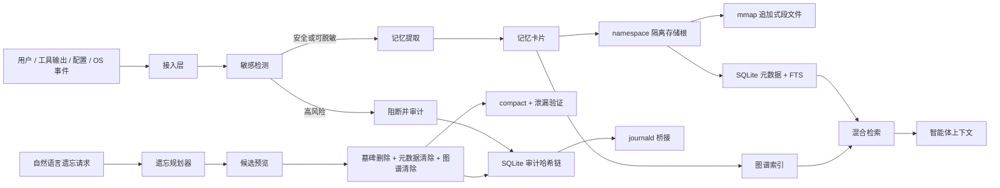

# MemGuardOS 总体设计

## 1. 项目定位

MemGuardOS 是面向 Linux/openKylin OS Agent 的记忆基础设施，解决三个核心问题：

1. 智能体如何从 Linux 工作流、用户偏好、工具输出和 OS 事件中提取有价值记忆？
2. 这些记忆如何在 Linux 机制下被检索、版本化、审计和资源约束？
3. 敏感或过期记忆如何以可审计、可验证、不可逆的方式精准遗忘？

MemGuardOS 不是通用 RAG demo，而是把智能体记忆当作 OS 管理资源，核心能力包括：

- 多源记忆接入；
- working/session/long_term 记忆层级；
- 追加式版本化存储；
- 图谱化知识记忆；
- 带 OS 上下文的敏感检测；
- 自然语言精准遗忘；
- 审计哈希链验证；
- openKylin/namespace/systemd/auditd/cgroup 验证路径。

## 2. 总体架构



## 3. 核心组件

| 组件 | 职责 | 当前证据 |
|---|---|---|
| CLI `memctl` | 用户与演示入口 | `ingest/search/forget/versions/rollback/doctor/...` |
| 记忆卡片 | 统一记忆 schema | `memguard/models.py` |
| 敏感检测器 | PII/凭据/自定义模式/OS 路径检测 | `memguard/sensitivity` |
| 追加式存储 | 版本段文件、mmap 读、compact 清除 | `memguard/store/mmap_store.py` |
| SQLite 元数据 | 元数据、FTS、审计、图谱表 | `memguard/store/sqlite_meta.py` |
| 混合检索器 | 词法 + 轻量向量式 + 图谱扩展 | `memguard/retrieval/hybrid.py` |
| 图谱记忆 | 实体/关系抽取和关联检索 | `memguard/extraction/entity.py` |
| 遗忘规划器 | 自然语言候选选择 | `memguard/forgetting/planner.py` |
| OS Guard | namespace、cgroup、journald、auditd、OS 事件 | `memguard/config.py`、`memguard/os_guard` |
| 评测模块 | 指标、延迟负载、报告 | `memguard/eval/run_eval.py` |

## 4. 记忆生命周期

1. **接入**：用户文本、文件、工具输出或 OS 事件进入 `memctl`。
2. **分类**：内容被分为偏好、知识或敏感策略。
3. **敏感检测**：检查敏感模式和 OS 来源路径。
4. **存储**：安全记忆写入当前 namespace 下的追加式段文件和 SQLite 元数据。
5. **结构化**：抽取实体和关系，写入图谱表。
6. **检索**：FTS 候选预筛选 + 混合重排 + 图谱扩展。
7. **更新/回滚**：更新和回滚都追加新版本，不覆盖历史。
8. **遗忘**：写入 tombstone、清理索引、compact、验证明文无泄漏。
9. **审计**：关键事件进入哈希链审计日志，并可镜像到 journald。

## 5. OS 机制

| 机制 | 目的 | 证据 |
|---|---|---|
| mmap | OS 支持的段文件读取 | `AppendOnlyMemoryStore.scan()` |
| 追加式 + compact | 版本历史与不可逆清除 | `mmap_store.py`、测试 |
| namespace 隔离 | 多会话/多项目记忆、审计和敏感规则隔离 | `memctl --namespace`、`namespace-status`、`memguardd@.service` |
| systemd/cgroup | 资源限制和实例化 daemon | `memguardd.service`、`memguardd@.service`、`memctl status` |
| journald | 系统审计集成 | `JournaldLogger` |
| auditd | 敏感路径监控 | `auditd-rules`、安装脚本 |
| OS 事件接入 | 接入 auditd/fanotify/eBPF 风格事件 | `ingest-os-event` |

## 6. 评测摘要

当前评测覆盖：

- 类型与子类型识别准确率；
- Recall@5 与跨语言 Recall@5；
- 图谱实体 Recall@5；
- 敏感阻断 F1 与脱敏 F1；
- 遗忘候选精确率/召回率；
- 冲突解决正确率；
- 记忆层级流转；
- 负载 P50/P95/P99；
- CPU、tracemalloc、RSS、存储占用。

生成命令：

```bash
python -m pytest -q
python -m memguard.eval.run_eval --latency-size 1000 --latency-queries 120 --output docs/eval_result.json --markdown docs/eval_report.md
```

## 7. 当前限制与处理策略

| 限制 | 处理策略 |
|---|---|
| 提取器以规则为主 | 保持离线可复现，并通过可选 adapter 接入 LLM/schema 抽取 |
| Kylin embedding 不作为默认主路径 | Python/C++ 探针均已返回 768 维向量，`MEMGUARD_EMBEDDING_BACKEND=auto` 实际检索可返回 `vector_backend: "kylin_sdk"`；默认检索保持轻量 FTS/hash/graph，保证跨环境复现 |
| Kylin 向量数据库不作为默认存储路径 | 已有真实 C++ 搜索探针证据；默认元数据和索引仍由 SQLite/mmap 承担，便于离线评测 |
| fanotify/eBPF 不是默认安全主路径 | auditd 已提供真实 OS 事件路径；bpftrace/eBPF 脚本作为可选增强，不影响默认验证链路 |
| benchmark 仍需扩大 | 提交前继续扩充困难样例 |
