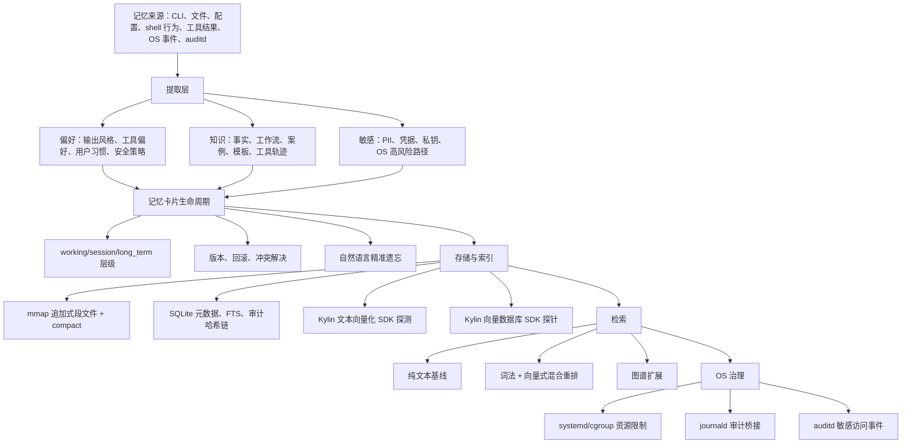

# MemGuardOS 满分目标规划

日期：2026-05-18

本文是赛题 3 项目的执行约束文档，目标是把 MemGuardOS 做成可争取国家级奖项的 openKylin 原生智能体记忆系统，而不是普通 RAG/记忆 demo。

## 1. 项目定位

MemGuardOS 的答辩定位：

> 面向 Linux/openKylin OS Agent 的轻量级记忆底座，支持多源记忆提取、结构化检索、敏感记忆治理、精准遗忘、审计追踪和 OS 级资源约束。

最终系统必须证明四件事：

1. 能从用户偏好、结构化配置、shell 行为历史、工具执行结果、知识片段、OS 事件、auditd 日志中提取记忆。
2. 能对记忆进行检索、更新、版本管理、冲突解决、层级流转和精准遗忘。
3. 敏感记忆治理不仅依赖应用层正则，还结合 Linux/openKylin 的审计和资源控制机制。
4. 能在 openKylin 上部署、验证、压测，并给出基线对比和可复现实验报告。

## 2. 满分架构

## 3. 得分点矩阵

| 得分点 | 满分目标 | 当前证据 | 后续动作 | 优先级 |
|---|---|---|---|---|
| openKylin 可运行 | 安装、测试、评测、服务均可复现 | VM 已验证，`openkylin_verify.sh` 可运行 | 提交前复跑并截图 | P0 |
| 文本向量化 SDK | 检测或使用 openKylin/Kylin SDK | 检测到 768 维端侧模型 | 推理超时保持可选，不虚假宣称 | P0 |
| 向量数据库 SDK | 至少有真实 SDK 调用证据 | C++ 探针完成插入和搜索 | Python 桥接作为可选增强 | P0 |
| 轻量化存储 | 本地、小占用、可 compact | mmap 段文件 + SQLite/FTS | 已加入存储 footprint 指标 | P0 |
| 检索延迟 | 100+ 查询 P95 < 500 ms | openKylin 10k P95 242.053 ms；openKylin 1k P95 83.761 ms | 视频录制前可快速复跑 | P0 |
| 多源记忆 | 文本、文件、配置、shell 行为、工具结果、OS 事件 | 已实现 | 可继续扩充桌面行为采集 | P1 |
| 偏好记忆 | 输出风格、工具偏好、习惯、安全策略 | subtype 与基准覆盖 | 增强 schema 抽取 | P1 |
| 知识记忆 | 事实、工作流、案例、模板、图谱 | 已实现图谱和冲突解决 | 扩充困难样例 | P1 |
| 跨语言检索 | 中文查询能命中英文记忆 | 基准通过 | 若 SDK 稳定再引入真实 embedding | P1 |
| 敏感治理 | PII、凭据、自定义、OS 路径 | 正则 + auditd 真实日志 | 可选 NER/LLM 校验 | P0 |
| 精准遗忘 | dry-run、确认、compact、验证 | 精确率/召回率 1.0 | 扩充 hard negative | P0 |
| OS 机制 | 至少三类机制证据 | mmap、systemd/cgroup、journald、auditd | fanotify/eBPF 可选 | P1 |
| 评测体系 | 指标、基线、资源、报告 | 已覆盖 | 提交前扩数据集 | P0 |
| 演示视频 | openKylin 上 3-5 分钟闭环 | 脚本已准备 | 功能冻结后录制 | P0 |

## 4. 最终验收门禁

提交前必须满足：

1. Windows 与 openKylin 上 `python -m pytest -q` 均通过。
2. openKylin 评测至少包含 1000 条负载记忆和 100 次以上检索请求。
3. 负载 P95 延迟低于 500 ms。
4. 精准遗忘候选精确率不低于 0.90。
5. 敏感阻断/脱敏 F1 不低于 0.95。
6. 至少三类 OS 机制有证据：mmap、systemd/cgroup、journald/auditd。
7. Kylin embedding/vector SDK 必须明确“已使用、已探测或受限回退”，不得过度宣称。
8. 评测报告必须包含 text-only、无图谱混合检索、完整 MemGuardOS 三类对比。
9. 遗忘后必须从元数据、FTS、图谱、段文件 compact 后明文中清除。
10. 最终演示视频必须在 openKylin 上录制。
11. 所有面向评委和用户的文档必须为中文；内部审阅索引可保留英文。

## 5. 最优解开发闭环

后续每个重要改动都必须遵守：

1. **需求匹配**：明确对应赛题得分点和验收证据。
2. **最佳实践核查**：必要时查 Linux/openKylin 文档、SDK 头文件或成熟开源项目。
3. **决策记录**：影响架构、SDK、存储、检索、OS 集成的改动必须更新 `docs/架构决策记录.md`。
4. **实现**：改动要小而可测，保留稳定 fallback。
5. **验证**：运行单元测试、评测、openKylin 验证或 OS 证据命令。
6. **规划更新**：同步更新本规划、测试报告、最终清单或验证文档。

当前已执行的闭环示例：

- Kylin 文本向量化 SDK 可检测但推理超时，因此采用“可选探测 + 稳定 fallback”，而不是把不稳定 SDK 强行接入主路径。
- Kylin 向量数据库 SDK 先用 C++ 探针验证真实调用，再考虑 Python 桥接。
- 发现 5k 记忆全量重排 P95 超标后，改为 FTS 候选预筛选，使 10k 负载 P95 降到 500 ms 以内。
- 发现资源报告缺少端侧存储指标后，补充段文件、SQLite、总 footprint、RSS 指标。
- 发现 Python 内置 `hash()` 会导致轻量向量排序存在进程级随机性后，改为 SHA-256 稳定哈希，增强评测可复现性。
- 发现“用户行为数据”证据不足后，补充 `ingest-history`，用 shell history 行为轨迹覆盖智能体常见工具行为。
- 发现本地 Agent API 正式环境权限表达不足后，补充 `--auth-token-file`，保留演示易用性同时支持令牌鉴权。

## 6. 当前最高价值路线

1. 功能冻结前只接受低风险补强，避免破坏已通过的 openKylin 指标。
2. 继续扩充困难样例，特别是敏感检测、精准遗忘 hard negative、跨语言检索。
3. 若时间允许，再实现可选 Python 向量 SDK 桥接或 fanotify/eBPF 增强。
4. 录制 openKylin 演示视频前快速复跑 pytest、1k 评测、SDK、systemd/cgroup、auditd、UKUI 通知。
5. 整理最终提交包。

## 7. 工程约束

1. 不删除轻量 fallback 路径。
2. 不把不稳定 SDK 强依赖化。
3. 每个核心功能至少要有测试、CLI/脚本证据和文档说明。
4. 每个 OS 级声明都必须能用 openKylin 命令输出或截图支撑。
5. 清单中任何“完成”都必须有证据，不能只写计划。
6. 如果发现当前方案不是最优，必须暂停实现，查权威资料或成熟开源项目，更新决策后再继续。
