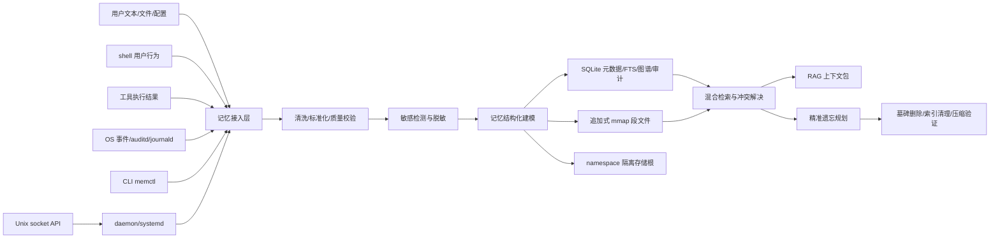

# MemGuardOS 项目介绍总览

本文是 MemGuardOS 的一站式中文介绍文档，面向评委、答辩老师和后续维护者。阅读本文可以快速了解项目目标、整体框架、核心算法、功能模块、创新亮点、文件树和各文件夹职责。

## 1. 项目定位

MemGuardOS 是面向研究生操作系统开源创新大赛赛题 3 的 Linux/openKylin 智能体记忆系统原型。项目目标不是做一个普通聊天记录库，而是围绕“面向 Linux 的智能体记忆提取与精准遗忘机制”构建一套可运行、可测试、可审计、可在 openKylin 上验证的系统。

项目重点解决六类问题：

1. 智能体记忆如何从用户文本、文件、结构化配置、shell 行为历史、工具执行结果、系统事件和审计日志中稳定提取。
2. 记忆如何结构化表示，支持偏好、知识、安全策略、工具轨迹和 OS 事件等不同类型。
3. 记忆如何高效检索，并在 RAG 生成前形成可控、已脱敏的上下文包。
4. 敏感信息如何在写入前识别、阻断或脱敏。
5. 用户提出“忘掉某类信息”时，系统如何自然语言定位候选、确认删除、清理索引和压缩物理存储。
6. 如何体现 Linux/openKylin 操作系统机制，而不是只停留在应用层字符串处理。

## 2. 项目目标

### 2.1 功能目标

- 支持多源记忆接入：手动文本、文件、结构化配置、shell 用户行为、工具执行结果、OS 事件、auditd 审计事件。
- 支持记忆分类：偏好记忆、知识记忆、敏感策略记忆。
- 支持记忆子类型：输出风格、工具偏好、安全策略、工作流、案例、模板、工具轨迹、用户行为、OS 事件。
- 支持记忆层级：`working`、`session`、`long_term`。
- 支持多会话隔离：默认 namespace 兼容旧路径，显式 namespace 使用独立段文件、独立 SQLite 元数据库和独立敏感规则文件。
- 支持混合检索：全文检索、稳定哈希向量检索、图谱关联、冲突解决。
- 支持精准遗忘：dry-run 预览、确认删除、墓碑标记、索引清理、段文件压缩、不可逆探针验证。
- 支持敏感治理：PII、凭据、私钥、中文姓名、中文地址、银行卡、AWS Key、自定义敏感规则。
- 支持 Linux/openKylin 集成：mmap 段文件、namespace 多会话隔离、SQLite FTS、systemd 服务、cgroup 资源限制、journald、auditd、Kylin SDK 探测、本地 Unix socket API。

### 2.2 竞赛目标

- 满足赛题核心要求：记忆提取、精准遗忘、敏感保护、轻量存储、openKylin 编译运行测试。
- 形成可复现实证：单元测试、评测指标、openKylin 证据包、systemd/cgroup 截图和日志证据。
- 做出可答辩亮点：OS 机制、审计哈希链、不可逆遗忘验证、端侧轻量化、SDK 兼容探测、可解释指标。

## 3. 总体框架

MemGuardOS 采用“核心服务 + CLI + daemon + 本地 API + OS 机制适配”的结构。



核心设计原则：

- **稳定优先**：比赛评测路径不依赖外部大模型服务，保证离线可运行。
- **轻量优先**：默认存储使用 mmap 段文件 + SQLite，不强依赖重型向量数据库。
- **隔离优先**：默认 namespace 兼容旧数据，显式 namespace 使用独立目录隔离记忆段、元数据库和敏感规则。
- **可解释优先**：分类、敏感检测、遗忘候选、审计链都能输出结构化证据。
- **openKylin 优先**：在 openKylin 虚拟机上实际安装、测试、采集证据包。

## 4. 核心算法与机制

### 4.1 记忆结构化算法

入口位于 `memguard/service.py`。系统将原始输入转换为 `MemoryRecord`：

- `type`：记忆大类，包括 `preference`、`knowledge`、`sensitive_policy`。
- `subtype`：记忆细类，例如 `tool_preference`、`workflow`、`tool_trace`、`os_event`。
- `scope`：当前 namespace，用于多会话/多项目隔离。
- `tier`：记忆层级，包括 `working`、`session`、`long_term`。
- `entities`/`relations`：实体和关系，用于图谱检索。
- `sensitivity`：敏感级别、标签、是否已脱敏。
- `version`：版本信息，用于创建、更新、回滚和遗忘。
- `audit`：哈希证据，用于审计链校验。

分类算法以可解释规则为主，优先保证比赛演示和测试可复现；后续可以接入 LLM schema extractor 作为增强路径。

### 4.2 多源接入算法

项目支持以下输入路径：

- 手动文本：`ingest_text`
- 文件内容：CLI 读取文件后进入文本接入
- 结构化配置：`ingest_config`
- shell 用户行为：`ingest_shell_history`
- 工具结果：`ingest_tool_result`
- OS 事件：`ingest_os_event`
- auditd 事件：解析 Linux 审计日志后转为 OS 事件

所有文本入口都会先经过 `memguard/ingestion/quality.py` 做清洗、标准化和质量校验：

- Unicode NFKC 标准化，移除 NUL/控制字符，合并多余空白和连续空行；
- 空输入、无中英文/数字信号的输入会被拒绝，并写入 `quality_reject` 审计事件；
- 低信号比、过短文本、过长截断、结构化信号不足会进入 `warnings`；
- 质量分会进入写入审计，并用于记忆 `confidence` 降权；
- CLI 提供 `memctl quality-report` 查看最近质量校验审计。

结构化配置接入还会做叶子节点质量检查：空值、非叶子配置等会进入 `skipped` 报告，避免把无效配置伪装成有效记忆。

### 4.3 敏感检测与脱敏算法

敏感检测位于 `memguard/sensitivity/detector.py`，自定义规则管理位于 `memguard/sensitivity/custom_patterns.py`。

检测对象包括：

- 邮箱、手机号、身份证号；
- 中文姓名、中文地址；
- 银行卡号；
- API Key、AWS Access Key ID；
- token/password/secret 赋值；
- private key；
- OS 高风险路径，例如 SSH 私钥、系统账户文件；
- 用户自定义敏感正则。

处理策略：

- 高风险内容直接阻断，不写入长期记忆；
- 中低风险内容脱敏后写入；
- RAG 上下文输出时携带 `redacted` 元数据；
- 自定义正则必须通过编译检查、空匹配检查和过宽匹配检查，避免用户误配导致系统大面积误杀。

### 4.4 混合检索算法

检索位于 `memguard/retrieval/hybrid.py`，综合使用：

- SQLite FTS 全文检索；
- 基于 SHA-256 的稳定哈希向量；
- cosine 相似度；
- 关键词和技术 token 扩展；
- 图谱实体召回；
- 冲突解决器。

选择稳定哈希向量的原因：

- 不依赖外部模型和网络；
- 不受 Python 进程随机哈希影响；
- 可在端侧快速运行；
- 与 Kylin SDK 探测路径并存，便于在 openKylin 环境逐步替换为系统 SDK。

### 4.5 图谱记忆算法

实体抽取位于 `memguard/extraction/entity.py`，关系以共现关系为主。系统把技术实体、工具名、配置名、Linux 机制名提取出来，用于：

- 图谱搜索；
- 相关记忆发现；
- Recall@5 指标评测；
- 答辩时展示“不是单纯关键词搜索”。

### 4.6 冲突解决算法

冲突解决位于 `memguard/retrieval/conflict.py`。当多条偏好或策略互相冲突时，系统按主题聚合，并结合更新时间、重要性和记忆类型选择更合理的结果，避免 RAG 上下文同时塞入互相矛盾的指令。

### 4.7 精准遗忘算法

精准遗忘由 `memguard/forgetting/planner.py` 和 `memguard/service.py` 协作完成。

流程如下：

1. 用户用自然语言提出遗忘请求。
2. 系统提取请求关键词和区别性关键词。
3. 检索候选记忆，生成 dry-run 计划。
4. 用户确认后写入墓碑标记。
5. 从元数据、FTS、图谱关系中排除已删除记忆。
6. 执行压缩后，从追加式段文件中物理移除明文。
7. 使用不可逆探针检查 metadata 和 segment 是否仍有明文泄漏。

这个机制对应赛题中的“精准遗忘”，不是简单删除一行数据库记录。

### 4.8 审计哈希链

审计链由 `SQLiteMetaStore.append_audit` 维护。每个关键操作都会写入事件、对象、详情、前序哈希和当前哈希。`verify-audit` 可以验证链条是否被篡改。

审计对象包括：

- 记忆写入；
- 敏感阻断；
- 精准遗忘；
- 压缩清除；
- 自定义敏感规则变更；
- 配置接入质量跳过。
- 输入质量拒绝和质量分报告。

### 4.9 OS 级机制

项目不是纯应用层 demo，已经接入多项 Linux/openKylin 机制：

- mmap：追加式段文件读取；
- namespace：多会话/多项目隔离存储根；
- SQLite FTS：轻量索引；
- systemd：后台 daemon；
- cgroup：MemoryMax、CPUQuota 资源约束，模板服务可为不同 namespace 建立独立实例；
- journald：系统日志桥接；
- auditd：敏感路径审计；
- Unix domain socket：本地 Agent API；
- Kylin SDK：文本向量化 SDK 已有 768 维真实向量探针，可作为可选重排后端；向量数据库 SDK 已有真实搜索探针。

## 5. 功能清单

| 功能 | 当前状态 | 主要入口 |
|---|---|---|
| 文本记忆写入 | 已实现 | `memctl ingest` |
| 文件记忆写入 | 已实现 | `memctl ingest --file` |
| 结构化配置写入 | 已实现 | `memctl ingest-config` |
| shell 用户行为写入 | 已实现 | `memctl ingest-history` |
| 工具结果写入 | 已实现 | `memctl ingest-tool-result` |
| OS 事件写入 | 已实现 | `memctl ingest-os-event` |
| auditd 事件接入 | 已实现 | `scripts/auditd_to_memguard.sh` |
| 输入质量报告 | 已实现 | `memctl quality-report` |
| 混合检索 | 已实现 | `memctl search` |
| 图谱检索 | 已实现 | `memctl graph-search` |
| RAG 上下文构建 | 已实现 | `memctl build-context` |
| LLM 提示词渲染 | 已实现 | `memctl build-prompt` |
| 可选 LLM 生成适配 | 已实现 | `memctl generate-answer`，默认 dry-run，不依赖外部 API |
| 精准遗忘 dry-run | 已实现 | `memctl forget` |
| 确认遗忘 | 已实现 | `memctl forget --yes` |
| 段文件压缩 | 已实现 | `memctl compact` |
| 不可逆验证 | 已实现 | `memctl verify-forget` |
| 版本查看和回滚 | 已实现 | `memctl versions`、`memctl rollback` |
| 审计链查看和验证 | 已实现 | `memctl audit`、`memctl verify-audit` |
| namespace 多会话隔离 | 已实现 | `memctl --namespace`、`namespace-status`、`namespaces` |
| SDK 状态探测 | 已实现 | `memctl sdk-status` |
| daemon 后台服务 | 已实现 | `memguardd`、`memguardd@<namespace>`、systemd |
| 本地 socket API | 已实现 | `/run/memguardos/memguard.sock`，支持可选令牌鉴权 |
| 评测报告 | 已实现 | `memguard.eval.run_eval` |
| 提交包生成 | 已实现 | `scripts/package_submission.py` |

## 6. 创新亮点

1. **记忆系统与 OS 机制结合**：将 namespace、auditd、journald、systemd、cgroup、mmap、Unix socket 放入同一条可演示链路。
2. **精准遗忘有物理验证**：不仅逻辑删除，还能压缩段文件并验证明文是否仍存在。
3. **敏感治理贯穿写入和生成前上下文**：写入前阻断/脱敏，RAG 输出携带 redacted 元数据。
4. **轻量端侧检索路径**：不依赖 GPU、不依赖云端大模型，适合 openKylin 端侧演示。
5. **可解释评测体系**：覆盖检索、敏感检测、遗忘、图谱、冲突解决、延迟、CPU、内存、存储。
6. **Kylin SDK 原生适配**：具备 openKylin 文本向量化 SDK 真实向量探针、可选 SDK 重排后端和向量数据库 SDK 搜索探针；默认轻量链路保证跨环境复现。
7. **工程化提交闭环**：测试、lint、证据包、提交包脚本、中文文档、审计记录全部具备。

## 7. 项目文件树

```text
memguardos/
├── .github/                          GitHub CI、Issue/PR 模板和维护配置
├── .devcontainer/                    可选 VS Code Dev Container 配置
├── memguard/                         核心 Python 包
│   ├── api/                          本地 Unix socket JSON API
│   │   ├── __init__.py
│   │   └── server.py
│   ├── cli/                          命令行入口
│   │   ├── __init__.py
│   │   └── memctl.py
│   ├── eval/                         评测指标与评测运行器
│   │   ├── __init__.py
│   │   ├── metrics.py
│   │   └── run_eval.py
│   ├── extraction/                   实体与关系抽取
│   │   ├── __init__.py
│   │   └── entity.py
│   ├── forgetting/                   精准遗忘规划
│   │   ├── __init__.py
│   │   └── planner.py
│   ├── ingestion/                    多源接入转换
│   │   ├── __init__.py
│   │   ├── behavior.py
│   │   ├── config.py
│   │   └── tool_result.py
│   ├── os_guard/                     Linux/openKylin OS 机制适配
│   │   ├── __init__.py
│   │   ├── auditd.py
│   │   ├── auditd_events.py
│   │   ├── cgroup.py
│   │   ├── doctor.py
│   │   ├── events.py
│   │   └── journald.py
│   ├── retrieval/                    检索、冲突解决、Kylin SDK 可选后端
│   │   ├── __init__.py
│   │   ├── conflict.py
│   │   ├── hybrid.py
│   │   └── kylin_sdk.py
│   ├── sensitivity/                  敏感检测和自定义规则
│   │   ├── __init__.py
│   │   ├── custom_patterns.py
│   │   └── detector.py
│   ├── store/                        存储层
│   │   ├── __init__.py
│   │   ├── mmap_store.py
│   │   └── sqlite_meta.py
│   ├── __init__.py
│   ├── config.py                     默认路径和环境配置
│   ├── daemon.py                     后台服务入口
│   ├── models.py                     记忆数据模型
│   └── service.py                    核心业务编排服务
├── scripts/                          部署、演示、证据采集和打包脚本
├── tests/                            单元测试
├── data/                             demo 数据和 benchmark 数据
├── docs/                             中文文档、评测报告、openKylin 证据
├── Dockerfile                        可选容器化开发环境
├── Makefile                          常用开发命令
├── pyproject.toml                    Python 包配置
├── requirements-dev.txt              开发依赖清单
├── README.md                         项目入口说明
├── CONTRIBUTING.md                   中文贡献指南
├── SECURITY.md                       中文安全策略
├── CHANGELOG.md                      中文变更日志
├── CODE_OF_CONDUCT.md                中文协作行为准则
└── LICENSE                           开源许可证
```

## 8. 主要文件夹说明

| 路径 | 作用 |
|---|---|
| `.github/` | GitHub Actions、Issue/PR 模板、代码所有者和依赖更新配置，属于开源工程化支撑。 |
| `.devcontainer/` | 可选 Dev Container 配置，方便在容器中复现开发环境，属于开发环境支撑。 |
| `memguard/` | 项目核心代码包，包含模型、服务、存储、检索、敏感检测、OS 适配和 daemon。 |
| `memguard/api/` | 本地 Unix socket API，供 OS Agent 或后台服务通过 JSON 命令调用。 |
| `memguard/cli/` | 命令行工具 `memctl`，用于演示、测试和手工验证。 |
| `memguard/eval/` | 评测指标和评测运行器，生成 Markdown/JSON 指标报告。 |
| `memguard/extraction/` | 实体与关系抽取，用于图谱记忆和关联检索。 |
| `memguard/forgetting/` | 精准遗忘候选规划和关键词匹配逻辑。 |
| `memguard/ingestion/` | 配置、shell 行为、工具结果等多源输入转换为记忆文本。 |
| `memguard/os_guard/` | Linux/openKylin 机制适配，包括 auditd、journald、cgroup、doctor。 |
| `memguard/retrieval/` | 混合检索、冲突解决、Kylin SDK 状态检测和可选重排后端。 |
| `memguard/sensitivity/` | 敏感信息检测、自定义规则校验和脱敏。 |
| `memguard/store/` | mmap 段文件和 SQLite 元数据/FTS/审计/图谱存储。 |
| `scripts/` | 安装、验证、演示、采证、打包脚本。 |
| `tests/` | 核心能力单元测试。 |
| `data/benchmarks/` | 评测样例，包括检索、遗忘、敏感检测、冲突解决、图谱召回。 |
| `data/demo/` | 演示输入数据。 |
| `docs/` | 中文设计文档、测试报告、评测结果、证据包索引。 |
| `docs/evidence/latest/` | 最新 openKylin 证据包，包括环境、测试、评测、namespace 隔离、systemd/cgroup、SDK 探测、auditd 等输出。 |

## 9. 核心代码文件说明

| 文件 | 说明 |
|---|---|
| `memguard/models.py` | 定义 `MemoryRecord`、`Sensitivity`、`VersionInfo`、`AuditInfo` 等核心数据结构。 |
| `memguard/service.py` | 项目核心编排层，负责接入、分类、敏感处理、namespace 隔离、存储、检索、遗忘、审计和上下文构建。 |
| `memguard/config.py` | 默认数据目录、namespace 隔离目录、数据库路径、段文件路径、自定义规则路径配置。 |
| `memguard/daemon.py` | daemon 进程入口，支持定时健康检查和 Unix socket API。 |
| `memguard/api/server.py` | 本地 JSON API，支持 `health`、`ingest`、`search`、`build_context`。 |
| `memguard/cli/memctl.py` | 命令行入口，封装写入、检索、遗忘、审计、评测辅助等命令。 |
| `memguard/store/mmap_store.py` | 追加式段文件存储，支持 mmap 读取、追加、压缩和泄漏探针。 |
| `memguard/store/sqlite_meta.py` | SQLite 元数据、FTS、版本、图谱、审计链存储。 |
| `memguard/retrieval/hybrid.py` | 稳定哈希向量、cosine 相似度和混合检索评分。 |
| `memguard/retrieval/conflict.py` | 偏好/策略冲突主题识别和冲突解决。 |
| `memguard/retrieval/kylin_sdk.py` | openKylin 文本向量化 SDK、向量数据库 SDK 状态检测和可选后端支撑。 |
| `memguard/sensitivity/detector.py` | 内置敏感信息检测、风险分级和脱敏。 |
| `memguard/sensitivity/custom_patterns.py` | 自定义敏感规则加载、保存和安全校验。 |
| `memguard/forgetting/planner.py` | 自然语言遗忘请求解析和候选记忆排序。 |
| `memguard/extraction/entity.py` | 技术实体、中文实体和共现关系抽取。 |
| `memguard/ingestion/config.py` | JSON 配置展开、质量校验和记忆文本转换。 |
| `memguard/ingestion/behavior.py` | shell history 行为解析、噪声过滤和用户行为记忆转换。 |
| `memguard/ingestion/quality.py` | 输入清洗、Unicode 标准化、质量评分、低质输入拒绝和审计报告。 |
| `memguard/ingestion/tool_result.py` | 工具执行结果结构化模型和摘要。 |
| `memguard/llm/adapter.py` | 默认关闭的 LLM adapter，支持 dry-run、本地命令和兼容 Chat Completions 的端点。 |
| `memguard/llm/prompt.py` | 把已脱敏上下文包渲染为 provider-neutral prompt。 |
| `memguard/os_guard/auditd.py` | auditd 规则生成和命令封装。 |
| `memguard/os_guard/auditd_events.py` | auditd 日志事件解析。 |
| `memguard/os_guard/cgroup.py` | cgroup v2 状态读取和资源限制证据。 |
| `memguard/os_guard/doctor.py` | 环境诊断，包括系统命令、路径、cgroup、Kylin SDK。 |
| `memguard/os_guard/events.py` | OS 事件 JSON 解析。 |
| `memguard/os_guard/journald.py` | journald/systemd-cat 日志桥接。 |
| `memguard/eval/metrics.py` | Recall、Precision、F1、延迟等指标计算。 |
| `memguard/eval/run_eval.py` | 评测主程序，读取 benchmark 并输出 JSON/Markdown 报告。 |

## 10. 脚本文件说明

| 文件 | 说明 |
|---|---|
| `scripts/demo_smoke.py` | 端到端演示脚本，覆盖写入、检索、图谱、敏感阻断、遗忘、审计。 |
| `scripts/install_openkylin.sh` | openKylin 基础依赖安装脚本。 |
| `scripts/openkylin_verify.sh` | openKylin 验证脚本。 |
| `scripts/collect_openkylin_evidence.sh` | 采集 openKylin 证据包，包括测试、评测、namespace、systemd/cgroup、SDK 状态。 |
| `scripts/memguardd.service` | systemd 服务文件，启动 memguard daemon 并设置资源限制。 |
| `scripts/memguardd@.service` | systemd 模板服务文件，为不同 namespace 启动独立 daemon、socket 和 cgroup。 |
| `scripts/install_auditd_rules.sh` | 安装 auditd 敏感路径审计规则。 |
| `scripts/auditd_to_memguard.sh` | 将 auditd 事件转换并写入 MemGuardOS。 |
| `scripts/kylin_vector_probe.cpp` | Kylin 向量数据库 SDK C++ 探针源码。 |
| `scripts/kylin_embedding_probe.cpp` | Kylin 文本向量化 SDK 官方 C API 风格 C++ 探针源码。 |
| `scripts/run_kylin_embedding_probe.sh` | 编译并运行 Kylin 文本向量化 SDK 探针。 |
| `scripts/run_kylin_vector_probe.sh` | 编译并运行 Kylin 向量 SDK 探针。 |
| `scripts/diagnose_kylin_embedding.sh` | 采集 Kylin embedding runtime、socket、插件、包版本、动态符号和日志证据包。 |
| `scripts/package_submission.py` | 生成提交 zip 包和 manifest，自动排除缓存、临时数据库、段文件和构建产物。 |
| `scripts/check_docs_links.py` | 检查 README 和 docs 中的本地 Markdown 链接是否失效。 |

## 11. 数据与评测文件说明

| 文件 | 说明 |
|---|---|
| `data/demo/linux_workflow.md` | 演示用 Linux 工作流文本。 |
| `data/demo/tool_result_success.json` | 演示用工具执行结果。 |
| `data/demo/user_config.json` | 演示用结构化用户配置。 |
| `data/benchmarks/memory_seed.jsonl` | 评测前写入的种子记忆。 |
| `data/benchmarks/retrieval.jsonl` | 检索 Recall@5 样例。 |
| `data/benchmarks/sensitive_detection.jsonl` | 敏感检测、阻断、脱敏样例。 |
| `data/benchmarks/forgetting.jsonl` | 精准遗忘评测样例。 |
| `data/benchmarks/conflict_resolution.jsonl` | 冲突解决评测样例。 |
| `data/benchmarks/graph_retrieval.jsonl` | 图谱召回评测样例。 |

## 12. 文档文件说明

| 文件 | 说明 |
|---|---|
| `docs/项目介绍总览.md` | 本文，一站式项目介绍。 |
| `docs/概要设计说明书.md` | 总体架构、模块关系和关键流程。 |
| `docs/详细设计说明书.md` | 关键类、接口、数据结构和流程细节。 |
| `docs/安全设计说明书.md` | 敏感检测、脱敏、阻断、遗忘安全策略。 |
| `docs/操作系统机制说明.md` | mmap、namespace、systemd、cgroup、journald、auditd 等 OS 机制说明。 |
| `docs/麒麟SDK集成证据.md` | Kylin embedding/vector SDK 探测和适配证据。 |
| `docs/openKylin验证记录.md` | openKylin 虚拟机验证记录。 |
| `docs/测试报告.md` | 单元测试、评测和端到端验证总结。 |
| `docs/赛题要求逐句符合性核查.md` | 对赛题要求逐句拆解并映射实现证据。 |
| `docs/评委证据包索引.md` | 指引评委快速找到证据。 |
| `docs/部署手册.md` | 本地和 openKylin 部署步骤。 |
| `docs/用户手册.md` | CLI 使用方式和常见操作。 |
| `docs/演示视频脚本.md` | 3-5 分钟演示视频脚本。 |
| `docs/答辩提纲.md` | 答辩讲解顺序和重点。 |
| `docs/eval_report*.md` | 程序生成的评测 Markdown 报告。 |
| `docs/eval_result*.json` | 程序生成的评测 JSON 数据。 |
| `docs/evidence/latest/` | 最新 openKylin 证据包。 |

## 13. 根目录文件说明

| 文件 | 说明 |
|---|---|
| `README.md` | 项目入口、快速开始和文档导航。 |
| `pyproject.toml` | Python 包元数据、依赖、命令入口、pytest 配置。 |
| `requirements-dev.txt` | 开发依赖清单，便于不使用 `pip install -e ".[dev]"` 时安装测试工具。 |
| `Makefile` | 常用命令：测试、评测、demo、doctor、lint、coverage、docs-check、ci、package、clean。 |
| `LICENSE` | MIT 开源许可证。 |
| `.gitignore` | 排除缓存、虚拟环境、临时数据库和段文件。 |
| `.gitattributes` | 规范文本换行和常见文本文件处理。 |
| `Dockerfile` | 可选容器化开发环境，方便复现测试，不是赛题功能本体。 |
| `.dockerignore` | 容器构建忽略规则，避免把 Git、缓存、证据包和运行时数据放入镜像上下文。 |
| `CONTRIBUTING.md` | 中文贡献指南，说明开发环境、质量门禁和不夸大原则。 |
| `SECURITY.md` | 中文安全策略，说明敏感数据、精准遗忘和审计相关问题的报告方式。 |
| `CHANGELOG.md` | 中文变更日志，记录稳定快照和工程化能力。 |
| `CODE_OF_CONDUCT.md` | 中文协作行为准则。 |

`.github/`、`.devcontainer/`、`Dockerfile`、`CONTRIBUTING.md`、`SECURITY.md`、`CHANGELOG.md`、`CODE_OF_CONDUCT.md`、`requirements-dev.txt` 属于开源维护和开发环境支撑；参赛功能主体仍以 `memguard/`、`scripts/`、`tests/`、`data/`、`docs/` 和根目录项目配置为准。

## 14. 当前验证状态

截至 2026-05-22，项目已完成以下验证：

- Windows 本机：`ruff` 静态检查通过，`41 passed`。
- openKylin 虚拟机：最新已采集证据为 `41 passed`，证据包时间戳为 `20260522_130156`。
- openKylin systemd 服务：`active`。
- namespace 多会话隔离：本地单元测试通过，openKylin 证据脚本已纳入 `namespace_isolation.txt` 和 `systemd_namespace.txt`。
- systemd 模板 cgroup：`memguardd@demo-a.service` 和 `memguardd@demo-b.service` 均为 `active`，独立 cgroup 中 `memory.max=536870912`、`cpu.max=50000 100000`。
- Unix socket API：健康检查返回 `ready`。
- openKylin 最新 1k 负载 P95：`65.367 ms`，RSS：`34240 KB`。
- openKylin 10k 负载 P95：`258.027 ms`，RSS：`65820 KB`。
- Kylin 文本向量化 SDK：Python/C++ 探针返回 `768` 维向量，实际可选检索后端返回 `vector_backend: "kylin_sdk"`。
- 并发审计：6 线程 72 条审计事件写入后哈希链验证通过。
- 端到端 smoke demo：Windows 和 openKylin 均通过。

## 15. 当前不足与后续增强

项目当前已经覆盖赛题核心要求，但仍有几个可以继续冲击更高完成度的方向：

1. **真实 eBPF/LSM 拦截器**：当前用 auditd 做真实 OS 审计，eBPF/LSM 仍是高风险增强项。
2. **UKUI 桌面联动**：当前已补 freedesktop/UKUI 桌面通知 smoke，后续可加 Peony 右键菜单或控制中心入口。
3. **Kylin embedding 默认主路径**：已具备 SDK 真实向量探针和实际可选重排检索证据；默认仍采用轻量 FTS/hash/graph 路径以保证跨环境复现。
4. **LLM schema extractor**：当前抽取器以规则为主，已补可选 LLM 生成 adapter；后续可在不影响离线评测的情况下把 adapter 扩展为 schema 抽取增强路径。
5. **更大 benchmark**：当前指标已经达标，后续可继续扩充难例，增强评审可信度。
6. **演示视频**：功能冻结后录制 3-5 分钟 openKylin 演示视频，展示多源接入、SDK、OS 机制、敏感阻断、精准遗忘和评测结果。

## 16. 推荐阅读顺序

1. `README.md`
2. `docs/项目介绍总览.md`
3. `docs/赛题要求逐句符合性核查.md`
4. `docs/概要设计说明书.md`
5. `docs/详细设计说明书.md`
6. `docs/测试报告.md`
7. `docs/评委证据包索引.md`
8. `docs/麒麟SDK集成证据.md`
9. `docs/操作系统机制说明.md`
10. `docs/答辩提纲.md`
